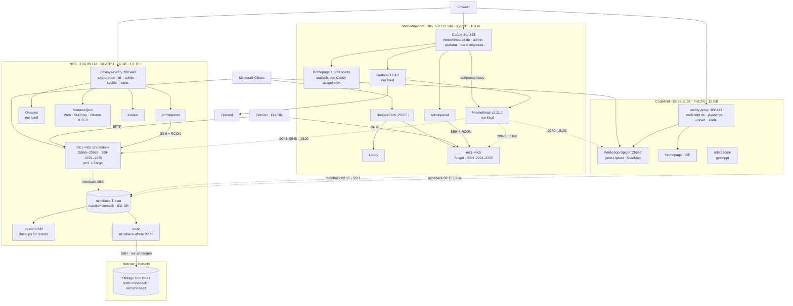

# Cubbermine – Beschreibung des Altsystems

**Stand:** 17.11.2026, erhoben direkt auf den drei Hosts (laufende Container, Compose-Projekte, Volumes, Timer, offene Ports); enthält die Sofortmaßnahmen vom 16.11.2026 ([planning.md](planning.md), Abschnitt S) und die neue Offsite-Kopie der Backups ([backups.md](backups.md)). Dieses Dokument beschreibt das **heute produktiv laufende System auf Docker-Compose-Basis**, das durch Cubbermine abgelöst werden soll. Zielarchitektur: [architecture.md](architecture.md); Analyse der Minecraft-Images: [dockerminecraft.md](dockerminecraft.md); Websites und Dienste: [websites-monitoring.md](websites-monitoring.md).

---

## 1. Überblick

Drei einzeln betriebene virtuelle Server beim selben Provider (netcup; erkennbar an Hostnamen und DNS-Server), jeweils mit Debian 13 und Docker. Es gibt **keinen Cluster und kein gemeinsames privates Netz**: Jeder Host betreibt seine Container mit eigenen Docker-Compose-Projekten und einem eigenen Caddy als HTTPS-Einstieg. Verbindungen zwischen den Hosts laufen über die öffentlichen IP-Adressen (Monitoring, Backups, Verwaltung per SSH).

| Host | Öffentliche IPv4 | Rolle | Hauptdomains |
|---|---|---|---|
| **MeckMinecraft** | `185.170.113.136` | Minecraft-Netzwerk mit BungeeCord und Lobby, Homepage, Monitoring-Zentrale | `meckminecraft.de` |
| **NC3** | `2.56.99.112` | Minecraft-Server einzeln erreichbar (Standalone), Backup-Tresor aller Hosts, weitere Webdienste | `cndrbrbr.de`, `*.cndrbrbr.de` |
| **Codefield** | `89.58.11.96` | JavaScript-Workshop-Server mit Webseiten, orbita2core (gestoppt) | `codefield.de` |

Netzqualität zwischen den Hosts (gemessen 14.–16.11.2026, [PreNetzwerkmessung.md](PreNetzwerkmessung.md)): ein Router dazwischen, RTT rund 0,5 ms, 1 Gbit/s je Host, Pfad-MTU 1500.

**Externe Dienste**, von denen das System abhängt:

| Dienst | Wofür |
|---|---|
| Hetzner Storage Box BX21 (Helsinki) | verschlüsselte Offsite-Kopie des Backup-Tresors (restic), seit 16.11.2026; Details in [backups.md](backups.md) |
| Let's Encrypt | TLS-Zertifikate der drei Caddy-Instanzen |
| Discord (Webhook) | Alarme aus Grafana, SSH-Login-Meldungen |
| SMTP des Providers | Login-Codes und Einladungen der Adminpanels |
| GitHub | Repositories aller Komponenten; Images werden heute noch auf den Hosts gebaut |
| DNS | Wildcard-Einträge `*.meckminecraft.de` → MeckMinecraft, `*.cndrbrbr.de` → NC3 |

### 1.1 Gesamtarchitektur

---

## 2. Hosts im Detail

Gemeinsam auf allen drei Hosts: Debian GNU/Linux 13 (trixie), Kernel 6.12.113, Docker 29.9.1 mit Compose 5.6.0, OpenSSH auf Port 22, `prometheus-node-exporter` auf Port 9100 (Basic Auth), mineback-Agent als systemd-Timer (täglich 02:15), SSH-Login-Benachrichtigung an Discord. Eine Host-Firewall gibt es nicht (INPUT-Policy `ACCEPT`); einzelne Regeln stehen in der Docker-Kette `DOCKER-USER`.

### 2.1 MeckMinecraft (`185.170.113.136`)

**Hardware:** 8 vCPU (QEMU), 16 GB RAM (davon ca. 10 GB belegt), 157 GB Platte (35 % belegt).

| Compose-Projekt (Pfad) | Container | Image | Öffentliche Ports |
|---|---|---|---|
| `minecrafthostingserver` (`/root/minecraftHostingServer`, Branch `main`, + Override) | `bungee` | eigenes Image (BungeeCord, OpenJDK 21) | 25565 |
| | `lobby` | eigenes Spigot-Image | 9940 (Metriken) |
| | `mc1`–`mc5` | eigenes Spigot-Image | SSH 2221–2225, Metriken 9941–9945 |
| | `adminpanel` | eigenes Image (Python 3.12) | – (über Caddy) |
| `minecraftdash` (`/root/mcDashProject/minecraftDash`) | `caddy` | `caddy:2-alpine` | 80, 443 |
| | `prometheus` | `prom/prometheus:v3.11.0` | 9090 nur lokal (`127.0.0.1`); öffentlich nur `/api/prometheus/` über Caddy |
| | `grafana` | `grafana/grafana:12.4.2` | 3000 nur lokal; öffentlich über Caddy `https://grafana.meckminecraft.de` |

**Konfiguration außerhalb von Git:** `minecraftDash/secrets/node-exporter-password` (node_exporter-Passwort für Prometheus), `grafana/provisioning/alerting/contactpoints.yaml` (Discord-Webhook, `skip-worktree`).

**Volumes (Größe):** `lobby_data` 1,1 GB, `mc1_data` 620 MB, `mc2_data` 560 MB, `mc3_data` 460 MB, `mc4_data` 400 MB, `mc5_data` 2,0 GB, `bungee_data` 50 MB, `adminpanel_data` 0,7 MB, `grafana-data` 51 MB, Caddy-Zertifikate. `prometheus-data` 1,1 GB (benannt seit 16.11.2026). Dazu rund 20 anonyme Volumes (Reste früherer Container, u. a. das frühere anonyme Prometheus-Volume mit 1,1 GB, dessen Daten ins benannte Volume kopiert wurden).

**Zeitgesteuert:** root-Cron stündlich `update-server-names.py` (schreibt Servernamen/MOTD für die Homepage-Karten), mineback-Agent 02:15.

**Firewall:** `DOCKER-USER`: Port 9940 von außen (eth0) gesperrt.

### 2.2 NC3 (`2.56.99.112`)

**Hardware:** 10 vCPU (AMD EPYC-Rome), 24 GB RAM (ca. 15 GB belegt), 1,5 TB Platte (**77 % belegt**, davon 831 GB mineback-Tresor und 170 GB Docker).

| Compose-Projekt (Pfad) | Container | Image | Öffentliche Ports |
|---|---|---|---|
| `minecrafthostingserver` (`/root/hostMC/minecraftHostingServer`, Branch `local-nc3`, + Override + `special-cases/mc1-forge`) | `mc1` (Forge, Typ `custom`) | eigenes Spigot-Image | Minecraft 25565, Voice-Chat **24454/udp**, SSH 2221, Metriken 9941 |
| | `mc2`–`mc5` | eigenes Spigot-Image | Minecraft 25566–25569, SSH 2222–2225, Metriken 9942–9945 |
| | `adminpanel` | eigenes Image | – (über omasys-caddy) |
| `omasys` (`/root/omasys/omasys`) | `omasys-caddy` | `caddy:2-alpine` | 80, 443 (HTTPS-Einstieg für **alle** Dienste auf NC3) |
| | `omasys` | eigenes Image (Node-App) | 3000 nur lokal (`127.0.0.1`, über `.env` seit 16.11.2026) |
| `nonamequiz` (`/root/nonamequiz-deploy`) | `nonamequiz-web` | `nginx:alpine` (Dateien direkt aus `/root/nonamequiz`) | – |
| | `nonamequiz-ai-proxy` | eigenes Image | – |
| | `nonamequiz-ollama` | `ollama/ollama:0.35.0` (mistral, nur CPU, max. 6 Kerne / 8 GB) | – |
| `kookie` (`/root/kookie/deploy`) | `kookie-web` | `nginx:alpine` | – |

Alle Webdienste hängen am Netz `omasys_default`, damit `omasys-caddy` sie erreicht; `mc4` und `mc5` ebenfalls (für die BlueMaps).

**Volumes (Größe):** `mc1_data` 1,8 GB, `mc2_data` 410 MB, `mc3_data` 1,4 GB, `mc4_data` **43 GB** (SoftSurvival), `mc5_data` 4,0 GB, `adminpanel_data` 0,4 MB, `omasys_omasys_data` 1,2 GB, `nonamequiz_ollama` 4,4 GB, Caddy. **Ungenutzte Altbestände:** `minecraft_mcsrv25` 69 GB, `minecraft_run` 17 GB, `minecraft_mcserver` 138 MB, `mcbuild25_*` 118 MB, `minecrafthostingserver_lobby_data` 223 MB und `_bungee_data` 26 MB (NC3 läuft ohne BungeeCord), mehrere anonyme Volumes; außerdem Verzeichnisse `/root/hostMC/backup` (21 GB) und `backup2` (18 GB).

**Außerhalb von Docker:**

| Dienst | Aufgabe |
|---|---|
| mineback-Tresor `/var/lib/mineback` (831 GB) | nimmt die verschlüsselten Backups **aller drei Hosts** an (Benutzer `mc-backup` per SSH) |
| nginx auf Port **8088** | liefert `/var/lib/mineback/public` aus; daraus holt der `restore`-Befehl der Minecraft-Container seine Backups (`BACKUP_URL`) |
| `mineback-freshness.timer` | schreibt Alter des letzten Backups als Metrik für node_exporter (Textfile-Collector) |
| `mineback-offsite.timer` (täglich 03:30) und `/usr/local/sbin/mineback-offsite` | verschlüsselte Kopie von `store/` mit restic auf die Hetzner Storage Box; SSH-Schlüssel `/root/.ssh/storagebox_ed25519` darf dort nur anhängen; Zugangsdatei und Passwort in `/root/.config/restic/`; Metriken in `mineback_offsite.prom`. Erstlauf (~830 GB) seit 16.11.2026, 23:35. Vor jedem Lauf sammelt `/usr/local/sbin/mineback-offsite-collect` Zugangsdateien von NC3 und MeckMinecraft nach `/var/lib/mineback-offsite-extra` (nur root), die mitgesichert werden |
| `kookie-import.timer` | vierteljährlicher Rezept-Import (1. Jan/Apr/Jul/Okt, 03:40) über `deploy/kookie-update.sh` |
| Kookie-Daten `/var/lib/kookie` (12 MB), Kochbuch-PDF `/root/BienesKochbuch.pdf` | Daten für `kookie-web` |

**Firewall:** `DOCKER-USER` → Kette `MC-METRICS`: Port 9940 nur von MeckMinecraft (`185.170.113.136`), sonst gesperrt; geladen von `mc-firewall.service` (`/root/hostMC/fw.sh`).

**Konfiguration außerhalb von Git:** `/root/omasys/omasys/.env` (Domain, Port nur lokal, Zugangsdaten; seit 16.11.2026), `/root/nonamequiz-deploy/` (kein Repository, `proxy.env` mit Zugangstoken), `keys/`, `secrets/` und `.env` von minecraftHostingServer.

### 2.3 Codefield (`89.58.11.96`)

**Hardware:** 4 vCPU (QEMU), 10 GB RAM (ca. 2,3 GB belegt), 235 GB Platte (24 % belegt).

| Compose-Projekt (Pfad) | Container | Image | Öffentliche Ports |
|---|---|---|---|
| `caddy-proxy` (`/root/caddy-proxy`) | `caddy-proxy-caddy-1` | `caddy:2-alpine` | 80, 443, 35581–35583, 35591–35593 (orbita2core) |
| `javascriptminecraftworkshopserver` (`/root/javascriptMinecraftWorkshopServer`, mit `docker-compose.proxy.yml`) | `…-spigot-1` | eigenes Spigot-Image (26.3) | Minecraft 25565, Metriken 9940; jsmn-Upload 25580 und BlueMap 8100 nur über Caddy |
| | `…-homepage-1` | eigenes Image (`nginx:trixie`, `envsubst`) | – |
| | `…-webscriptcraft-1` | eigenes Image (`nginx:trixie`) | – |
| `testo2c` (`/root/testo2c`) | orbita2core-Knoten und Sim-Agenten | eigene Images | **zurzeit gestoppt** |

**Volumes (Größe):** `minecraft_data` 4,7 GB, `testo2c_node1-data` … `node3-data` je 7,3 GB, Caddy-Volumes (auch ungenutzte des eingebauten Caddy des Workshop-Projekts und von testo2c).

**Zeitgesteuert:** mineback-Agent 02:15.

**Hinweise:** Der Workshop-Server hat kein RCON; Konsolenbefehle nur über `docker attach`. Er wird **nicht** mit `start_production.sh` gestartet (das würde einen zweiten Caddy auf 80/443 starten), sondern mit `docker compose -f docker-compose.yml -f docker-compose.proxy.yml up -d` und Umgebungsvariablen für Domain, IDE- und Upload-Adresse. Port 9940 ist noch nicht durch eine Firewallregel geschützt; die Regel ist vorbereitet (`/root/fw-metrics.sh`, Unit `mc-firewall.service`), aber noch nicht aktiviert.

---

## 3. Technischer Aufbau der Bausteine

### 3.1 Minecraft-Server (minecraftHostingServer)

Repository [minecraftHostingServer](https://github.com/cndrbrbr/minecraftHostingServer), auf MeckMinecraft (Branch `main`) und NC3 (Branch `local-nc3`) eingesetzt. Die Compose-Datei wird von `setup.sh` erzeugt; hostspezifische Einstellungen stehen in `docker-compose.override.yml` (auf NC3 über `COMPOSE_FILE` in `.env` geladen).

- **Ein Image für alle Server:** Debian trixie-slim mit GraalVM CE 25 (für die JavaScript-Engine von script4kids), BuildTools, Plugin-Katalog (alle freigegebenen Plugins je Minecraft-Version) und SSH-Server.
- **Spigot wird zur Laufzeit gebaut** (beim ersten Start einer Version, 5–10 Minuten) und als Jar auf dem Volume abgelegt; aktuelle Version 26.3.
- **Prozessmodell:** Bash-Entrypoint als PID 1 startet sshd und Java in einer Neustart-Schleife; „gestoppt“ heißt: Java aus, Container läuft weiter (Markerdatei `.stopped`).
- **Daten je Server** in einem eigenen Volume: `/server/data/cfg`, `/server/data/plugins`, `/server/data/worlds`, daneben Jar, Logs, `whitelist.json`, `ops.json`, SSH-Hostschlüssel, RCON-Passwort.
- **Zwei Servertypen:** `spigot` (verwaltet) und `custom` (eigene Server-Software mit `start.sh`, z. B. Forge auf NC3 mc1 mit Simple Voice Chat).
- **Modi:** MeckMinecraft im **BungeeCord-Modus** (alle Spieler über Port 25565, Server intern, `online-mode=false` hinter dem Proxy, Lobby nur für Admins verwaltbar); NC3 im **Standalone-Modus** (jeder Server mit eigenem Port, `online-mode=true`).
- Ausführliche Analyse: [dockerminecraft.md](dockerminecraft.md), Abschnitt 1.

### 3.2 Verwaltung: Adminpanel und FileZilla

- **Adminpanel** (je eine Instanz auf MeckMinecraft und NC3, `admin.meckminecraft.de` bzw. `admin.cndrbrbr.de`): Anmeldung mit E-Mail, Passwort und Code per E-Mail; Rollen Schüler (nur eigener Server) und Lehrkraft (alle Server). Funktionen: Start/Stopp/Neustart, Plugins aus dem Katalog installieren, eigene Plugins hochladen, Whitelist und Operator-Rechte, `server.properties` bearbeiten, Server zuweisen/freigeben, Aktionsprotokoll. Kein Restore von Backups in der Oberfläche.
- Das Adminpanel hat **keinen Docker-Socket**. Es steuert die Server über SSH mit den Schlüsseln des jeweiligen Servers (Benutzer `mc-ctrl`, Befehle über `mc-dispatch.sh`) und über RCON im Container. Mails gehen über SMTP des Providers.
- **FileZilla:** SFTP je Server (Benutzer `mc-sftp`, chroot auf den eigenen Server), Ports 2221–2225 auf beiden Hosts. **PuTTY wird nicht mehr genutzt**; der `mc-ctrl`-Zugang dient nur noch dem Adminpanel.
- Schlüssel liegen je Host in `keys/` neben der Compose-Datei, nicht im Repository.

### 3.3 Websites und HTTPS

Je Host ein Caddy mit Let's-Encrypt-Zertifikaten:

| Host | Caddy | Domains → Ziel |
|---|---|---|
| MeckMinecraft | `caddy` (minecraftDash) | `meckminecraft.de` → statische Homepage + `/api/prometheus/*` → Prometheus; `admin.meckminecraft.de` → Adminpanel; `grafana.meckminecraft.de` → Grafana (seit 16.11.2026); `karte-inigresso.meckminecraft.de` → BlueMap `mc2:8100` |
| NC3 | `omasys-caddy` | `cndrbrbr.de` → Omasys; `ai.cndrbrbr.de` → NonameQuiz; `admin.cndrbrbr.de` → Adminpanel; `kookie.cndrbrbr.de` → Kookie (Basic Auth); `karte.cndrbrbr.de` → BlueMap `mc5:8100`; `karte-softsurvival.cndrbrbr.de` → BlueMap `mc4:8100` |
| Codefield | `caddy-proxy` (`admin off`) | `codefield.de`, `www.codefield.de` → Workshop-Homepage; `javascript.codefield.de` → IDE; `upload.codefield.de` → `spigot:25580`; `karte.codefield.de` → BlueMap `spigot:8100`; `o2c.codefield.de:35581–35583/35591–35593` → orbita2core |

Mehrere Caddy-Blöcke wurden von Hand ergänzt und werden beim erneuten Ausführen der jeweiligen `setup.sh` überschrieben (MeckMinecraft). DNS: `*.cndrbrbr.de` als Wildcard auf NC3.

### 3.4 Monitoring und Benachrichtigung

- **Prometheus** (MeckMinecraft, alle 15 s): Job `minecraft` mit statischer Zielliste (Codefield :9940, MeckMinecraft :9940–9945, NC3 :9941–9945; Labels `server_name`, `local_name`) und Job `node` (node_exporter :9100 der drei Hosts, Label `machine`). Die Minecraft-Metriken liefert das Plugin PrometheusExporter in jedem Server (bei Forge: Mod + `metrics-adapter.py`).
- **Grafana** (MeckMinecraft, `https://grafana.meckminecraft.de`): Dashboard `minecraft.json`, Alert-Regeln (Server, Backups) mit Discord-Webhook, alles als Provisioning-Dateien.
- Prometheus und Grafana sind seit 16.11.2026 nur noch lokal bzw. über Caddy erreichbar; das node_exporter-Passwort liest Prometheus aus einer Datei außerhalb von Git.
- **Öffentliche Statusseite** `meckminecraft.de/server.html` fragt Prometheus direkt aus dem Browser ab; Karten-Titel (MOTD) aus `homepage/servers.json`, stündlich aktualisiert.
- **SSH-Logins** auf allen Hosts werden an Discord gemeldet.

### 3.5 Backups (mineback)

Repository [mineback](https://github.com/cndrbrbr/mineback).

- **Agent** auf jedem Host (`mineback-agent.timer`, täglich 02:15): sichert die Minecraft-Server (MeckMinecraft mc1–mc5, Lobby und Proxy; NC3 mc1–mc5; Codefield den Workshop-Server), verschlüsselt mit `age` und überträgt per SSH an den Tresor.
- **Tresor** auf NC3 (`/var/lib/mineback`, 831 GB): `store/<host>/servers|fleets`, Katalog `catalog.sqlite`, öffentlich lesbare Sicht `public/` über nginx :8088 für den `restore`-Befehl der Container.
- **Aufbewahrung** laut `mineback.toml`: `keep_last = 1`, keine täglichen/wöchentlichen/monatlichen Stände; dauerhaft behalten werden Backups mit den Gründen `pre-restore`, `pre-version`, `workshop-final`.
- **Offsite-Kopie** (seit 16.11.2026): `mineback-offsite` auf NC3 sichert `store/` täglich um 03:30 mit restic auf die Hetzner Storage Box in Helsinki. Verschlüsselt beim Absender, 25 MB/s, niedrige Priorität; der Zugang von NC3 darf nur anhängen (getestet: Löschen → `403 Forbidden`). Der Erstlauf mit rund 830 GB läuft; danach nur noch Änderungen. Konzept und Anleitung: [backups.md](backups.md).
- **Überwachung:** `mineback-freshness` (NC3) liefert das Alter des letzten Backups an Prometheus; Grafana alarmiert per Discord. Für die Offsite-Kopie schreibt `mineback-offsite` eigene Metriken (`mineback_offsite_*`); der Alarm dafür folgt nach dem Erstlauf.
- Zusätzlich das ältere `backup.sh` von minecraftHostingServer (ZIP von `cfg`/`plugins`/`worlds`) und manuelle Sicherungen in `/root/hostMC/backup*`.

### 3.6 Weitere Dienste (NC3, Codefield)

| Dienst | Aufbau |
|---|---|
| Omasys | Node-App mit Datenverzeichnis `/data` im Volume, Zugang über PIN/Passwort/JWT aus `.env`; ihr Caddy ist zugleich Einstieg für alle NC3-Domains |
| NonameQuiz | statische Web-App (nginx, direkt aus dem Git-Checkout), KI-Proxy mit Zugangstoken, Ollama mit Modell mistral auf der CPU (`OLLAMA_KEEP_ALIVE=30m`, `NUM_PARALLEL=1`, `MAX_QUEUE=4`) |
| Kookie | statische Rezept-Website (nginx) mit Daten aus `/var/lib/kookie/data`, Basic Auth im Caddy; Import-Container (`kookie-importer`, `kookie-kochbuch`) nur beim vierteljährlichen Lauf |
| orbita2core (testo2c) | drei Orbital-Knoten (HTTP :8080, je 7,3 GB Daten) und drei Sim-Agenten (:9200); zurzeit gestoppt |

---

## 4. Port-Übersicht (öffentlich)

| Port | MeckMinecraft | NC3 | Codefield |
|---|---|---|---|
| 22/tcp | SSH (Admin) | SSH (Admin, mineback-Tresor) | SSH (Admin) |
| 80, 443/tcp | Caddy | omasys-caddy | caddy-proxy |
| 2221–2225/tcp | SFTP mc1–mc5 | SFTP mc1–mc5 | – |
| 3000/tcp | nur lokal (Grafana, seit 16.11.2026) | nur lokal (Omasys, seit 16.11.2026) | – |
| 8088/tcp | – | nginx (Backups für `restore`) | – |
| 9090/tcp | nur lokal (Prometheus, seit 16.11.2026) | – | – |
| 9100/tcp | node_exporter (Basic Auth) | node_exporter (Basic Auth) | node_exporter (Basic Auth) |
| 9940–9945/tcp | Metriken (9940 von außen gesperrt) | Metriken (nur von MeckMinecraft) | Metriken 9940 (noch offen; Regel vorbereitet) |
| 24454/udp | – | Voice-Chat mc1 (Forge) | – |
| 25565/tcp | BungeeCord | mc1 | Workshop-Server |
| 25566–25569/tcp | – | mc2–mc5 | – |
| 35581–35583, 35591–35593/tcp | – | – | orbita2core über Caddy (Dienste gestoppt) |

---

## 5. Repositories und Konfigurationsorte

| Repository | Host / Pfad | Besonderheiten |
|---|---|---|
| minecraftHostingServer | MeckMinecraft `/root/minecraftHostingServer` (`main`), NC3 `/root/hostMC/minecraftHostingServer` (`local-nc3`) | erzeugte `docker-compose.yml` lokal geändert; Override-Datei, `.env`, `keys/`, `secrets/` nur auf dem Host |
| minecraftDash (öffentlich) | MeckMinecraft `/root/mcDashProject/minecraftDash` | seit 16.11.2026 eingecheckt (Commit `d7dc594`); `secrets/` und `*.bak-*` per `.gitignore` ausgeschlossen; Push nur über NC3 (dort liegt der GitHub-Schlüssel) |
| javascriptMinecraftWorkshopServer | Codefield `/root/javascriptMinecraftWorkshopServer` | Start mit Proxy-Override, keine `.env` |
| caddy-proxy | Codefield `/root/caddy-proxy` | |
| testo2c (orbita2core) | Codefield `/root/testo2c` | |
| omasys | NC3 `/root/omasys/omasys` | Caddyfile mit von Hand ergänzten Blöcken für alle NC3-Domains; `.env` nur auf dem Host |
| nonamequiz (+ Deploy-Ordner) | NC3 `/root/nonamequiz`, `/root/nonamequiz-deploy` | Live-Checkout wird direkt ausgeliefert (lokale Änderung `ai-service.js` mit Token, nie einchecken); Deploy-Ordner ist kein Repository |
| kookie | NC3 `/root/kookie` | privates Repository |
| mineback | NC3 `/root/mineback`; Konfiguration `/etc/mineback/` auf allen Hosts | Offsite-Skript `mineback-offsite` liegt bisher nur auf NC3 (später als mineback-Feature T9) |

---

## 6. Schwachstellen und Befunde

| Bereich | Befund |
|---|---|
| Sicherheit | ~~Prometheus (:9090), Grafana (:3000) und Omasys (:3000) direkt per HTTP öffentlich~~ – behoben 16.11.2026; offen: `/api/prometheus/` vollständig offen, keine Host-Firewall, Metrik-Port 9940 auf Codefield offen (Regel vorbereitet), Passwort des Storage-Box-Hauptkontos muss geändert werden |
| Backups | Der Tresor aller drei Hosts liegt auf NC3. **Offsite-Kopie seit 16.11.2026 eingerichtet** (restic auf Hetzner Storage Box, nur anhängen); bis der Erstlauf abgeschlossen ist, gibt es noch keine vollständige Kopie an einem anderen Ort. Im Tresor nur der letzte Stand (`keep_last = 1`) plus markierte Sonderstände. Offen: Alarm für die Offsite-Kopie, Admin-Zugang zum Aufräumen, Box-Snapshots, Restore-Test ([backups.md](backups.md)) |
| Speicher | NC3-Platte zu 77 % belegt; rund 86 GB in ungenutzten alten Volumes und 39 GB in manuellen Backup-Ordnern |
| Daten | ~~Prometheus nur mit anonymem Volume; Images ohne feste Version~~ – behoben 16.11.2026 (benanntes Volume; Prometheus v3.11.0, Grafana 12.4.2, Ollama 0.35.0) |
| Nachvollziehbarkeit | lokale, nicht eingecheckte Änderungen (generierte Compose-Dateien, Caddyfiles; minecraftDash am 16.11.2026 eingecheckt); von Hand ergänzte Konfigurationsblöcke, die bei `setup.sh` verloren gehen; mehrere Einstellungen nur in Dateien auf den Hosts. `.env` und `keys/` von minecraftHostingServer sichert mineback verschlüsselt mit (`hostconf-secrets.age`); Omasys-`.env`, NonameQuiz-Deploy-Dateien (inkl. `proxy.env`), `minecraftDash/secrets/` und den Grafana-Contact-Point sammelt seit 17.11.2026 `mineback-offsite-collect` vor jedem Offsite-Lauf ein; sie liegen damit nur in der Offsite-Kopie, nicht im Tresor. Das restic-Passwort wird bewusst nicht gesichert (muss offline liegen) |
| Betrieb | Spigot-Build zur Laufzeit (lange Erststarts); BungeeCord löst Backend-Adressen nur beim Start auf (nach Neuanlage der Server `bungee` neu starten); kein gemeinsames Netz, jede Querverbindung über öffentliche IPs; Verwaltung je Host getrennt (zwei Adminpanels, drei Caddy-Konfigurationen) |
| Verfügbarkeit | jeder Dienst hängt an genau einem Host; bei Ausfall eines Hosts sind dessen Server und Websites weg, bei NC3 zusätzlich der Backup-Tresor |

Die Befunde fließen in die Planung ein ([planning.md](planning.md): Sofortmaßnahmen im Bestand, M2 Archiv und Monitoring, M4 Migration).
