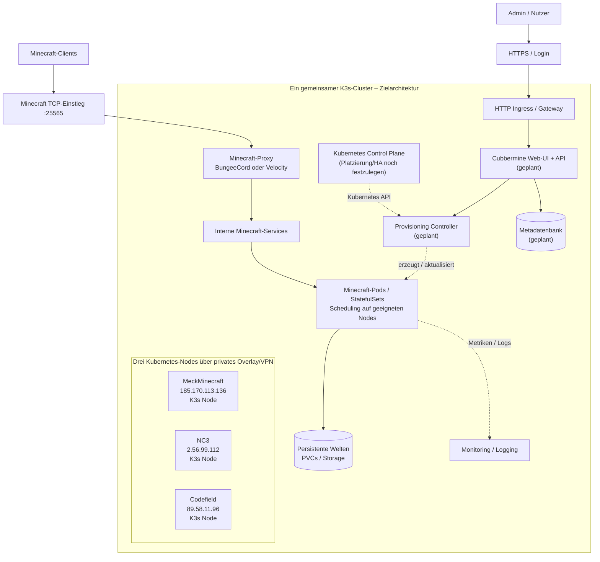
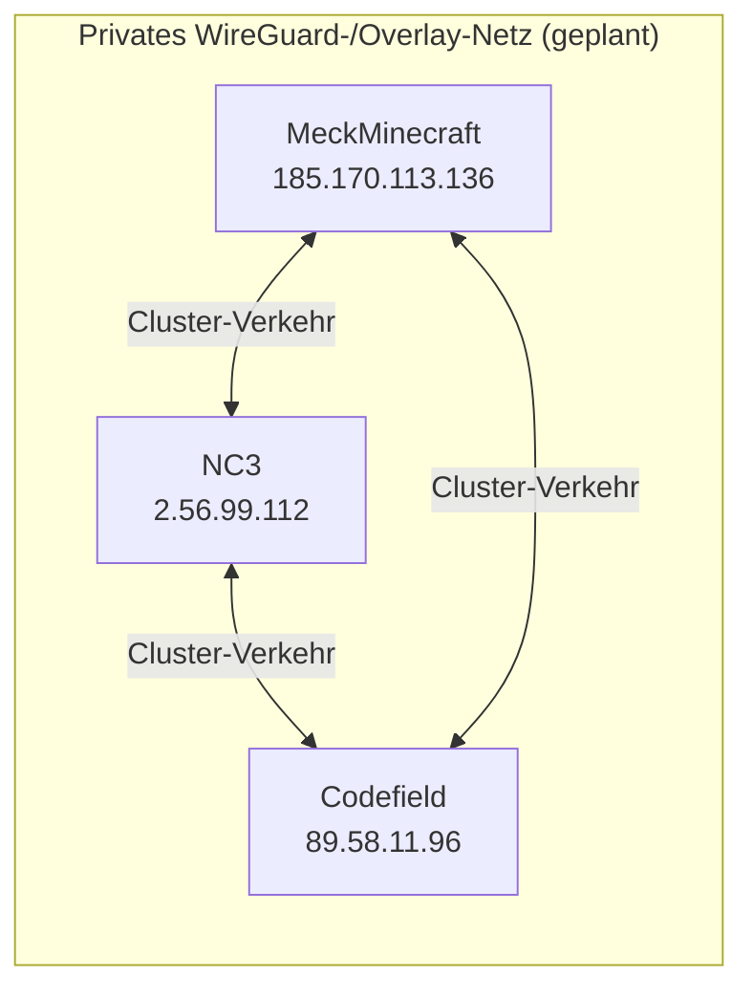

# Cubbermine – Architektur

**Status:** Zielarchitektur (Entwurf, 14.11.2026). Gewählte Variante **B**: **ein gemeinsamer K3s/Kubernetes-Cluster** über die drei vorhandenen Hosts. Dies ist ein Plan, kein bereits installierter Cluster.

## Ziel

Cubbermine ist eine geplante Kubernetes-basierte Minecraft-Hosting-Plattform. Eine zentrale Verwaltungs-API bzw. ein Adminpanel soll Minecraft-Server erstellen, konfigurieren, starten, stoppen, überwachen und löschen können. Die vorhandenen Docker-Compose-Workloads werden schrittweise migriert.

## Bestandsinfrastruktur

| Host | Öffentliche IPv4 | Aktuelle Container (Auszug) |
| --- | --- | --- |
| MeckMinecraft | `185.170.113.136` | BungeeCord, Lobby, mc1–mc5, Caddy, Grafana, Prometheus |
| NC3 | `2.56.99.112` | mc1–mc5, Caddy, Omasys, NonameQuiz |
| Codefield | `89.58.11.96` | Spigot/ScriptCraft, Workshop-Webseiten, Caddy |

Die Docker-Bridge-Netzwerke sind **hostlokal**; ein gemeinsames Cluster-Netz oder bestehende private Verbindungen sind aus den Inventaren **nicht nachgewiesen**.

## Zielbild: ein gemeinsamer K3s-Cluster

**Hinweis zur Darstellung:** Die Nodes sind die verfügbaren Ausführungsorte; Minecraft-Pods sind bewusst *nicht dauerhaft* einem bestimmten Host zugeordnet. Ob ein Pod tatsächlich verschiebbar ist, hängt vor allem von Speicher, Node-Affinity und Netzwerkkonfiguration ab.

### Physische/Netzwerk-Topologie (geplant)

Die öffentlichen IP-Adressen sind Bestandsdaten und **nicht** als ungeschützte Kubernetes-Endpunkte vorgesehen. Für Node-zu-Node-Kommunikation werden private VPN-Adressen festgelegt. Vor Inbetriebnahme: K3s-Kompatibilität des Netzwerks, Routing, MTU, Latenz, Firewall und DNS prüfen.

## Architekturbausteine

- **K3s Control Plane:** Scheduling, API und Clusterverwaltung. Ob eine einzelne Control Plane oder eine HA-Konfiguration praktikabel ist, wird erst nach Messungen zu Netzwerklatenz, Quorum und Ausfallszenarien entschieden. Drei räumlich/administrativ getrennte Hosts garantieren keine HA.
- **K3s Nodes:** alle drei bestehenden Hosts sollen dem *selben* Cluster angehören; notwendige Labels, Taints und Ressourcenreserven werden definiert.
- **Cubbermine API/Controller (geplant):** kontrollierte Bereitstellung der Ressourcen; Authentifizierung, Autorisierung, Quotas, Status und Audit.
- **Minecraft-Server:** je Instanz vorzugsweise ein `StatefulSet` mit `replicas: 1`, internem `Service`, ressourcenbegrenztem Container und eigenem `PersistentVolumeClaim`. **Keine** gleichzeitigen Schreibzugriffe mehrerer Pods auf dieselbe Welt.
- **Minecraft-Proxy:** zentraler öffentlich erreichbarer TCP-Einstieg; Backends nur intern. BungeeCord kann übernommen oder Velocity später geprüft werden.
- **Web-UI:** Deployment und HTTP Ingress/Gateway; Ingress ersetzt **nicht** automatisch einen Minecraft-TCP-Proxy.
- **Storage:** PVC/StorageClass, getestete Backups und Restore. Lokaler Speicher bindet den Pod üblicherweise an einen Node; echtes Failover braucht geeignete Storage- und Datenstrategie.
- **Betrieb:** Monitoring (Prometheus/Grafana), Probes, Logs, Alerts, Kubernetes Events.

## Kubernetes-Ressourcen

| Fachobjekt | Kubernetes-Ressourcen |
| --- | --- |
| Minecraft-Serverinstanz | StatefulSet (1 Pod), Service, PVC |
| Proxy | Deployment/StatefulSet, TCP Service |
| Web-UI/API | Deployment, Service, Ingress |
| Konfiguration | ConfigMap, Secret |
| Projekt/Mandant | Namespace, RBAC, ResourceQuota, NetworkPolicy |
| Speicher | PersistentVolumeClaim + StorageClass |
| Betrieb | Probes, Metrics, Events, Backup-Jobs |

## Bereitstellungsablauf (Soll)

1. Benutzer authentifiziert sich und beantragt einen Minecraft-Server mit Typ, Version, CPU, RAM und Speicher.
2. API prüft Berechtigungen, Quotas, Ressourcen und zulässige Images.
3. Controller provisioniert Konfiguration, PVC, StatefulSet und internen Service.
4. Kubernetes plant den Pod auf einem geeigneten Node.
5. Minecraft-Proxy-Routing wird kontrolliert eingerichtet; API meldet Status und Zugangsadresse.
6. Stopp über Skalierung auf null, PVC bleibt erhalten. **Löschen** und **Welt löschen** bleiben separate Aktionen.

## Sicherheit

Kubernetes-API nur über VPN/administrativen Zugang. RBAC mit minimalen Rechten, TLS, restriktive Pod-Sicherheit, Netzwerksegmentierung/NetworkPolicies (CNI-Unterstützung prüfen), keine Secrets im Git, sichere Proxy-Weiterleitung, Rate-Limits und Audit-Logging. Öffentlich freigeben nur benötigte Ports; Minecraft-Backends nicht direkt exponieren.

## Offene Architekturentscheidungen / Risiken

1. Control-Plane-Host(s), Etcd/Quorum, Ausfall- und Wiederanlaufkonzept.
2. WireGuard-Topologie, private Adressen, DNS, MTU, CNI und Firewall.
3. StorageClass, PVC-Bindung, Hostausfall und Backup/Restore.
4. Minecraft-Proxy (BungeeCord oder Velocity), öffentliche TCP-Adresse und Portstrategie.
5. K3s-Version, Node-Kapazität, Java-RAM-Overhead, CPU und Pod-Platzierung.
6. API-Schnittstellen, Operator/Controller oder Kubernetes-Client, Auth, Mandantentrennung.
7. Migration von Welten, Plugins, Konfiguration, Netzwerken und bestehenden Webdiensten.

## Migrationsprinzip

**Kein Big Bang:** zuerst ein K3s-Pilot mit einem nichtkritischen Minecraft-Server, anschließend kontrolliertes Hinzufügen der weiteren Hosts zum **gemeinsamen Cluster**. Datenexport, konsistentes Backup, Restore-Probe, Erreichbarkeit und Rollback werden pro Dienst geprüft. Produktive Compose-Container bleiben bis zur Abnahme bestehen.

Siehe [features.md](features.md) und [planning.md](planning.md).
