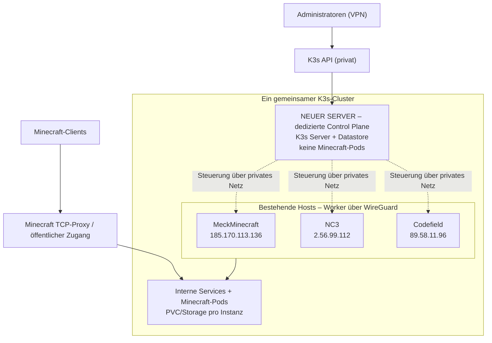
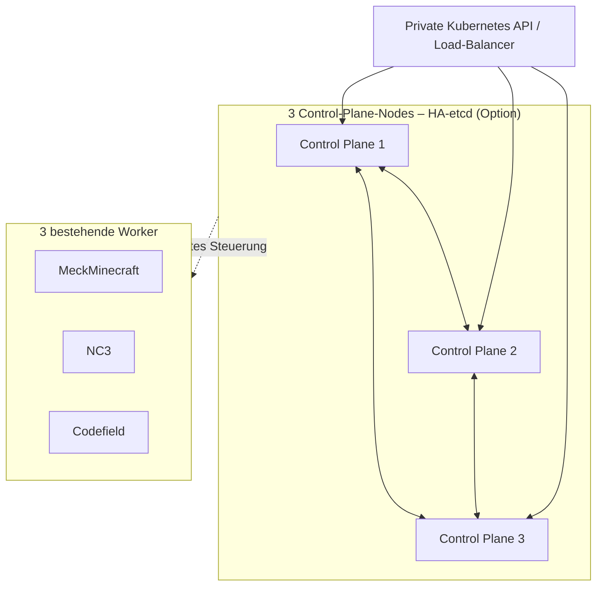
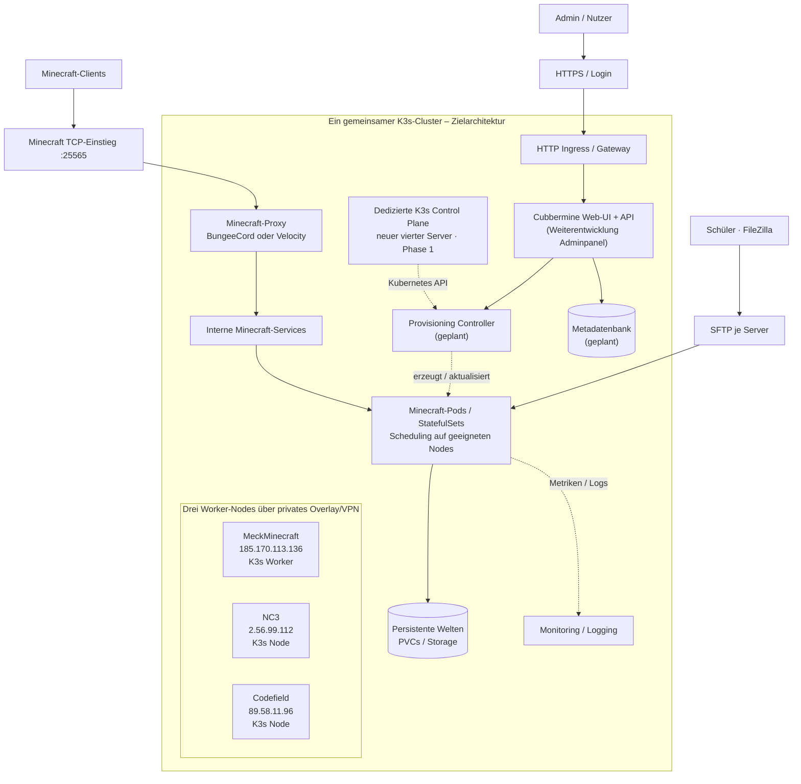
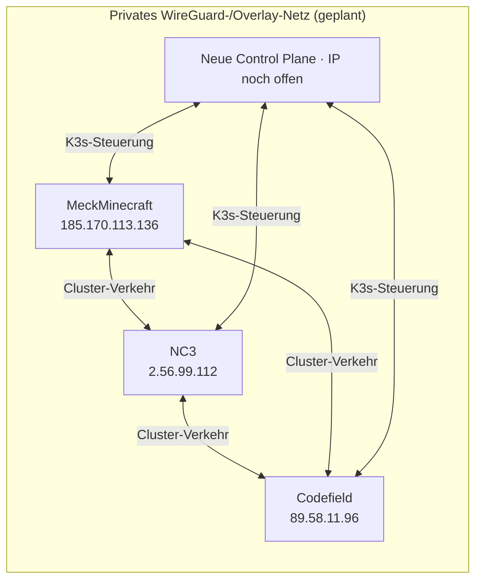

# Cubbermine – Architektur

**Status:** Zielarchitektur (Entwurf, 14.11.2026). Gewählte Variante **B**: **ein gemeinsamer K3s/Kubernetes-Cluster mit einer neu anzumietenden dedizierten Control Plane und den drei bestehenden Hosts als Worker-Nodes**. Dies ist ein Plan, kein bereits installierter Cluster.

## Ziel

Cubbermine ist eine geplante Kubernetes-basierte Minecraft-Hosting-Plattform. Eine zentrale Verwaltungs-API mit Weboberfläche (Weiterentwicklung des bestehenden Adminpanels) soll Minecraft-Server erstellen, konfigurieren, starten, stoppen, überwachen und löschen können. Die vorhandenen Docker-Compose-Workloads werden schrittweise migriert.

## Bestandsinfrastruktur

| Host | Öffentliche IPv4 | Aktuelle Container (Auszug) |
| --- | --- | --- |
| MeckMinecraft | `185.170.113.136` | BungeeCord, Lobby, mc1–mc5, Adminpanel, Caddy, Grafana, Prometheus |
| NC3 | `2.56.99.112` | mc1–mc5, Adminpanel, Caddy (Omasys), Omasys, NonameQuiz, Kookie |
| Codefield | `89.58.11.96` | Spigot/ScriptCraft, Workshop-Webseiten, Caddy |

**Bestehende Verwaltung:** Auf MeckMinecraft und NC3 läuft je ein **Adminpanel** (Weboberfläche, `admin.meckminecraft.de` bzw. `admin.cndrbrbr.de`) aus dem Projekt minecraftHostingServer. Schüler und Lehrkräfte melden sich mit E-Mail, Passwort und einem Code per E-Mail an und verwalten dort ihre Server: Start/Stopp, Plugins, Spieler und Einstellungen; Lehrkräfte weisen Server zu und geben sie frei. Das Adminpanel hat keinen Docker-Socket; es steuert die Server über SSH mit den Schlüsseln des jeweiligen Servers und über RCON, hat also nicht mehr Rechte als ein Schüler auf seinem eigenen Server. PuTTY wird für die Verwaltung nicht mehr genutzt. Für den direkten Dateizugriff nutzen Schüler weiterhin **FileZilla** (SFTP, je Server ein eigener Port, chroot auf den eigenen Server). Codefield hat kein Adminpanel. Details: [dockerminecraft.md](dockerminecraft.md), Abschnitt 1.3.

Die Docker-Bridge-Netzwerke sind **hostlokal**; ein gemeinsames Cluster-Netz oder bestehende private Verbindungen sind aus den Inventaren **nicht nachgewiesen**.

## Control-Plane-Strategie und Ausbaupfad

**Phase 1 (Entscheidung):** Ein zusätzlicher, dedizierter Server führt die einzige K3s-Control-Plane aus. MeckMinecraft, NC3 und Codefield laufen als **drei reine Worker-Nodes**. Damit ist die Verwaltungslast vom Minecraft-Workload getrennt; alle drei bestehenden Hosts bleiben für Anwendungs-Pods nutzbar. Die Control Plane ist aber **ein Single Point of Failure**. Bereits laufende Pods können bei einem Ausfall grundsätzlich weiterlaufen, sofern Netzwerk, Storage und Abhängigkeiten verfügbar bleiben; Scheduling, Controller-Reconciliation und administrative Änderungen sind eingeschränkt bzw. nicht verfügbar.

**Phase 2 (Option):** Ausbau zu **drei Control-Plane-Nodes** und unverändert drei Worker-Nodes, mit geeigneter HA-API-Adresse/Load-Balancer und einer getesteten K3s-etcd-Quorum-Konfiguration. Das ist **nicht** automatisch Teil des MVP und setzt ausreichende Netzwerkqualität sowie eine geplante Migration des Datastores voraus. Drei Control-Plane-Nodes tolerieren bei intaktem Quorum den Ausfall eines einzelnen Control-Plane-Nodes; sie garantieren kein ausfallfreies Minecraft oder Storage-HA.

**Grobe Planungsgröße für den neuen Control-Plane-Server (keine Messung):** 2–4 vCPU, 4–8 GiB RAM, 40–80 GB SSD und gesicherter VPN-Anschluss. Dimensionierung nach Clustergröße, Monitoring und Lasttests verifizieren. Die Control Plane soll keine normalen Minecraft-Workloads ausführen (Node-Taints/Absicherung prüfen). Öffentliche Minecraft-Ports führen **nicht** über die Kubernetes-API/Control Plane.

### Phase 1 – dedizierte Control Plane und drei Worker

### Phase 2 – möglicher HA-Ausbau

**Technischer Vorbehalt:** Das Beispiel mit drei etcd-Mitgliedern ist nur sinnvoll, wenn RTT, Bandbreite, Paketverlust, Firewall und Ausfallszenarien den stabilen Betrieb erlauben. HA-Control-Plane und HA-Storage sind getrennte Entscheidungen.

## Zielbild: ein gemeinsamer K3s-Cluster

**Hinweis zur Darstellung:** Die Nodes sind die verfügbaren Ausführungsorte; Minecraft-Pods sind bewusst *nicht dauerhaft* einem bestimmten Host zugeordnet. Ob ein Pod tatsächlich verschiebbar ist, hängt vor allem von Speicher, Node-Affinity und Netzwerkkonfiguration ab.

### Physische/Netzwerk-Topologie (geplant)

Die öffentlichen IP-Adressen sind Bestandsdaten und **nicht** als ungeschützte Kubernetes-Endpunkte vorgesehen. Für Node-zu-Node-Kommunikation werden private VPN-Adressen festgelegt. Vor Inbetriebnahme: K3s-Kompatibilität des Netzwerks, Routing, MTU, Latenz, Firewall und DNS prüfen.

## Architekturbausteine

- **K3s Control Plane:** Phase 1: ein neuer dedizierter Server als einzige Control Plane (bewusster SPOF). Phase 2: optional zwei weitere Control-Plane-Server, sofern etcd-HA und Netzwerkbedingungen getestet sind.
- **K3s Worker-Nodes:** alle drei bestehenden Hosts sollen als reine Worker dem *selben* Cluster angehören; notwendige Labels, Taints und Ressourcenreserven werden definiert.
- **Cubbermine API/Controller (geplant):** kontrollierte Bereitstellung der Ressourcen; Authentifizierung, Autorisierung, Quotas, Status und Audit.
- **Minecraft-Server:** je Instanz vorzugsweise ein `StatefulSet` mit `replicas: 1`, internem `Service`, ressourcenbegrenztem Container und eigenem `PersistentVolumeClaim`. **Keine** gleichzeitigen Schreibzugriffe mehrerer Pods auf dieselbe Welt.
- **Minecraft-Proxy:** zentraler öffentlich erreichbarer TCP-Einstieg; Backends nur intern. BungeeCord kann übernommen oder Velocity später geprüft werden.
- **Web-UI:** Weiterentwicklung des bestehenden Adminpanels (heute je eine Instanz auf MeckMinecraft und NC3). In Cubbermine gibt es **eine gemeinsame Weboberfläche für alle Server**, unabhängig davon, auf welchem Node sie laufen; die bisherigen Domains leiten dorthin um. Sie arbeitet über die Cubbermine API statt über SSH je Server; Deployment und HTTP Ingress/Gateway. Ingress ersetzt **nicht** automatisch einen Minecraft-TCP-Proxy. Einen SSH-Befehlszugang für Nutzer (früher PuTTY) gibt es nicht mehr.
- **Dateizugang:** SFTP für FileZilla als Sidecar im Minecraft-Pod, eigener TCP-Service je Server, bisherige Ports und Schlüssel bleiben (siehe [dockerminecraft.md](dockerminecraft.md)).
- **Storage:** PVC/StorageClass, getestete Backups und Restore. Lokaler Speicher bindet den Pod üblicherweise an einen Node; echtes Failover braucht geeignete Storage- und Datenstrategie.
- **Adresskonzept (Entscheidung 16.11.2026):** **meckminecraft.de** ist die Hauptadresse für alles rund um Minecraft (Homepage, Statusseite, gemeinsame Weboberfläche `admin.meckminecraft.de`, Grafana, Karten, Minecraft-Server, JavaScript-Workshop); **cndrbrbr.de** für die anderen Themen (Omasys, NonameQuiz mit lokaler KI, Kookie); **codefield.de** für orbita2core. Alte HTTP-Adressen leiten weiter; Minecraft-Server werden über einen Router auf Port 25565 nach Namen erreicht. Details: [websites-monitoring.md](websites-monitoring.md).
- **Websites und Dienste:** zustandslose Websites als Deployments hinter dem HTTP-Ingress (Namespace `websites`); Omasys, NonameQuiz/Ollama und Kookie im Namespace `cndrbrbr` (Ollama fest auf NC3 mit niedrigerer Priorität als die Minecraft-Server, Kookie-Import als CronJob); orbita2core im Namespace `orbita2core`. BlueMaps und der Skript-Upload laufen im jeweiligen Minecraft-Pod.
- **Betrieb:** Monitoring mit kube-prometheus-stack (Prometheus, Alertmanager, node_exporter, kube-state-metrics) und Grafana im Namespace `monitoring`, Übernahme der bestehenden Dashboards und Discord-Alerts, externer Wächter für Cluster-Ausfälle; Probes, Logs, Kubernetes Events.

## Kubernetes-Ressourcen

| Fachobjekt | Kubernetes-Ressourcen |
| --- | --- |
| Minecraft-Serverinstanz | StatefulSet (1 Pod), Service, PVC |
| Proxy | Deployment/StatefulSet, TCP Service |
| Web-UI/API | Deployment, Service, Ingress |
| SFTP-Zugang | Sidecar-Container im Minecraft-Pod, TCP Service, Secret (authorized_keys) |
| Konfiguration | ConfigMap, Secret |
| Projekt/Mandant | Namespace, RBAC, ResourceQuota, NetworkPolicy |
| Speicher | PersistentVolumeClaim + StorageClass |
| Betrieb | Probes, Metrics, Events, Backup-Jobs |

## Bereitstellungsablauf (Soll)

1. Benutzer authentifiziert sich und beantragt einen Minecraft-Server mit Typ, Version, CPU, RAM und Speicher.
2. API prüft Berechtigungen, Quotas, Ressourcen und zulässige Images.
3. Controller provisioniert Konfiguration, PVC, StatefulSet und internen Service.
4. Kubernetes plant den Pod auf einem geeigneten Node.
5. Minecraft-Proxy-Routing wird kontrolliert eingerichtet; API meldet Status und Zugangsadresse.
6. Stopp über Skalierung auf null, PVC bleibt erhalten. **Löschen** und **Welt löschen** bleiben separate Aktionen.

## Sicherheit

Kubernetes-API nur über VPN/administrativen Zugang. RBAC mit minimalen Rechten, TLS, restriktive Pod-Sicherheit, Netzwerksegmentierung/NetworkPolicies (CNI-Unterstützung prüfen), keine Secrets im Git, sichere Proxy-Weiterleitung, Rate-Limits und Audit-Logging. Öffentlich freigeben nur benötigte Ports; Minecraft-Backends nicht direkt exponieren. Grundsatz aus dem bestehenden Adminpanel beibehalten: Die Weboberfläche bzw. API erhält nur die Rechte, die sie für die eigenen Minecraft-Ressourcen braucht; Nutzer bekommen keinen Shell- oder SSH-Befehlszugang, nur Weboberfläche und chroot-SFTP.

## Offene Architekturentscheidungen / Risiken

1. Neuen Control-Plane-Host beschaffen und dimensionieren; Phase-1-Datastore, Backup/Restore und Single-Point-of-Failure dokumentieren; Phase-2-etcd/Quorum-Migrationspfad gesondert testen.
2. WireGuard-Topologie, private Adressen, DNS, MTU, CNI und Firewall.
3. StorageClass, PVC-Bindung, Hostausfall und Backup/Restore.
4. Minecraft-Proxy (BungeeCord oder Velocity), öffentliche TCP-Adresse und Portstrategie.
5. K3s-Version, Node-Kapazität, Java-RAM-Overhead, CPU und Pod-Platzierung.
6. API-Schnittstellen, Operator/Controller oder Kubernetes-Client, Auth, Mandantentrennung.
7. Migration von Welten, Plugins, Konfiguration, Netzwerken und bestehenden Webdiensten.

## Migrationsprinzip

**Kein Big Bang:** zuerst die dedizierte Control Plane auf dem neuen Server, dann ein K3s-Pilot mit einem nichtkritischen Minecraft-Server, anschließend kontrolliertes Hinzufügen der weiteren Hosts zum **gemeinsamen Cluster**. Datenexport, konsistentes Backup, Restore-Probe, Erreichbarkeit und Rollback werden pro Dienst geprüft. Produktive Compose-Container bleiben bis zur Abnahme bestehen.

Siehe [features.md](features.md) und [planning.md](planning.md).
