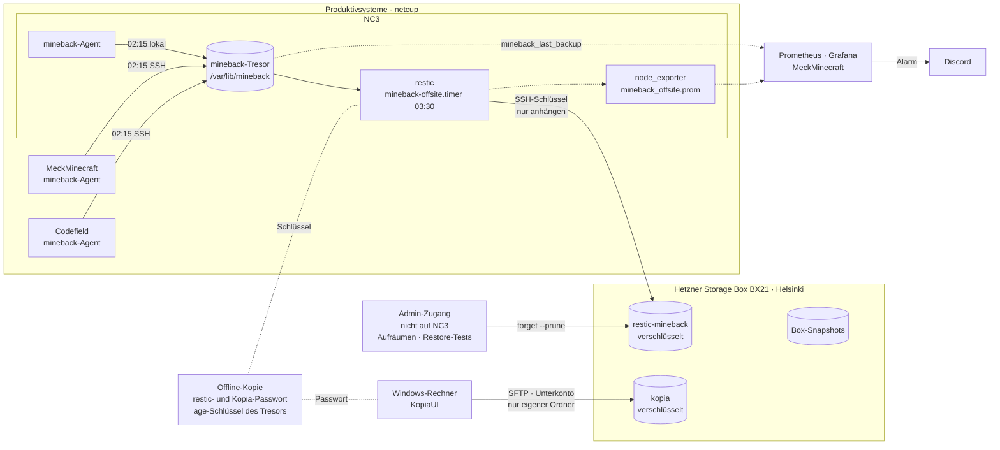

# Cubbermine – Backupkonzept und Anleitungen

**Stand:** 16.11.2026. Beschreibt die Backups des laufenden Systems ([altsystem.md](altsystem.md)), die Offsite-Kopie aus den Sofortmaßnahmen ([planning.md](planning.md), Abschnitt S) und die Sicherung eines Windows-Rechners auf dieselbe Storage Box. Für den späteren Cluster gilt dasselbe Ziel als Archiv ([planning.md](planning.md), M2).

> Dieses Repository ist öffentlich. Zugangsdaten, Passwörter und der echte Benutzername der Storage Box stehen deshalb **nicht** hier. Platzhalter: `uXXXXXX` = Benutzer der Storage Box, `uXXXXXX-subN` = Unterkonto.

---

## 1. Backupkonzept

### 1.1 Grundsätze

1. **3-2-1:** mindestens drei Kopien, auf zwei verschiedenen Systemen, eine davon an einem anderen Ort bei einem anderen Anbieter.
2. **Verschlüsselt, bevor die Daten das Haus verlassen.** Die Storage Box sieht nur verschlüsselte Pakete.
3. **Wer sichert, darf nicht löschen.** Der Zugang, mit dem ein Server sichert, kann auf dem Ziel nur anhängen. Löschen und Aufräumen geht nur mit einem getrennten Zugang, der nicht auf dem gesicherten Server liegt. Ein gehackter Server kann so seine eigenen Backups nicht zerstören.
4. **Schlüssel getrennt aufbewahren.** Passwörter und Schlüssel der Backups liegen zusätzlich offline (Papier/USB, zwei Orte). Ohne sie ist jede Kopie wertlos.
5. **Überwacht und getestet.** Jede Backupstufe meldet ihr Alter als Metrik, Grafana alarmiert per Discord, Restores werden regelmäßig geübt.

### 1.2 Stufen

| Stufe | Was | Wo | Werkzeug | Häufigkeit | Aufbewahrung |
|---|---|---|---|---|---|
| 1 | Minecraft-Server aller drei Hosts (Welten, Plugins, Konfiguration, Spielerlisten, Geheimnisse mit `age` verschlüsselt) | mineback-Tresor auf NC3 (`/var/lib/mineback`) | mineback-Agent je Host, SSH-Push | täglich 02:15 | letzter Stand + markierte Sonderstände (`pre-restore`, `pre-version`, `workshop-final`) |
| 2 | Inhalt des Tresors (`store/`) und Zugangsdateien außerhalb des Tresors (siehe 2.5) | Hetzner Storage Box BX21, Helsinki, Verzeichnis `restic-mineback` | restic über `rclone serve restic --append-only` | täglich 03:30 | Vorschlag: 14 täglich, 8 wöchentlich, 12 monatlich (Aufräumen mit getrenntem Zugang) |
| 3 | Ganze Storage Box | auf der Box selbst | automatische Box-Snapshots von Hetzner | täglich (geplant) | bis zu 20 Snapshots |
| – | Windows-Rechner (eigene Dateien) | Storage Box, eigenes Unterkonto, Verzeichnis `kopia` | Kopia (KopiaUI) über SFTP | stündlich | Kopia-Richtlinie, siehe 3.5 |

Stufe 3 schützt gegen Fehler mit dem Hauptkonto, z. B. versehentliches Löschen über WebDAV oder SMB. Sie liegt aber beim selben Anbieter und ersetzt keine der anderen Stufen.

### 1.3 Architektur



### 1.4 Zugänge zur Storage Box

| Zugang | Wer benutzt ihn | Rechte |
|---|---|---|
| Hauptkonto `uXXXXXX` mit Passwort | nur Admin, über die Hetzner Console, WebDAV oder SFTP | alles; daher nicht für automatische Sicherungen verwenden |
| SSH-Schlüssel von NC3 (`/root/.ssh/storagebox_ed25519`) im Hauptkonto | restic auf NC3 | fester Befehl `rclone serve restic --stdio --append-only restic-mineback`: nur dieses Verzeichnis, nur anhängen, keine Shell |
| Admin-Schlüssel zum Aufräumen (geplant) | Admin von einem Rechner außerhalb von NC3 | fester Befehl `rclone serve restic --stdio restic-mineback` ohne `--append-only` |
| Unterkonto `uXXXXXX-subN` | Kopia auf dem Windows-Rechner | nur das eigene Basisverzeichnis |

### 1.5 Überwachung

| Metrik | Quelle | Alarm |
|---|---|---|
| `mineback_last_backup_timestamp_seconds{host,server}` | `mineback-freshness` auf NC3 | besteht bereits (Grafana → Discord) |
| `mineback_offsite_last_success_timestamp_seconds` | `/usr/local/sbin/mineback-offsite` auf NC3 | geplant: älter als 36 h |
| `mineback_offsite_last_run_exit_code` | ebenda | geplant: ungleich 0 |
| `mineback_offsite_extra_collect_ok` | ebenda | geplant: 0 |
| Windows-Rechner | KopiaUI zeigt das Alter des letzten Snapshots | Sichtkontrolle; optional Kopia-Benachrichtigung per E-Mail |

### 1.6 Wiederherstellung (Übersicht)

| Fall | Weg |
|---|---|
| Einzelner Server, Tresor intakt | wie bisher: `restore` im Adminpanel bzw. Steuerbefehl, oder `mineback restore server <host>/<server>` |
| NC3 oder Tresor verloren | neuen Tresor-Host aufsetzen, `restic restore` aus der Storage Box (Abschnitt 2.7), danach mineback-Restore |
| Dateien vom Windows-Rechner | KopiaUI → Snapshots → Dateien durchsuchen oder als Laufwerk einhängen (Abschnitt 3.6) |

---

## 2. Anleitung: restic unter Debian mit der Storage Box

So ist die Offsite-Kopie auf NC3 eingerichtet (Debian 13). Die Anleitung lässt sich für weitere Debian-Hosts übernehmen; dann Verzeichnis, Schlüssel und Dateinamen anpassen.

### 2.1 Voraussetzungen in der Hetzner Console

1. Storage Box → Einstellungen: **SSH-Support** einschalten (ggf. auch „Externe Erreichbarkeit“, weil die Hosts nicht bei Hetzner stehen). Bis die Änderung greift, können ein paar Minuten vergehen.
2. Optional **automatische Snapshots** einschalten (Stufe 3).

Die Box hat eine eingeschränkte Shell: ein Befehl pro SSH-Aufruf, keine Pipes oder Umleitungen. `help` zeigt die erlaubten Befehle. Als Server-Gegenstück sind u. a. `rclone serve restic --stdio`, `borg`, `rsync` und `sftp` verfügbar.

### 2.2 Pakete und Schlüssel auf dem Debian-Host

```bash
apt-get install restic                      # Debian 13: restic 0.18
ssh-keygen -t ed25519 -N '' -C 'nc3-restic-offsite (append-only writer)' \
    -f /root/.ssh/storagebox_ed25519
```

### 2.3 Verzeichnisse und Schlüssel auf der Box (einmalig, mit Passwort)

```bash
H=uXXXXXX@uXXXXXX.your-storagebox.de
ssh -p 23 $H mkdir .ssh
ssh -p 23 $H mkdir restic-mineback

# authorized_keys lokal vorbereiten: fester Befehl, nur anhängen
printf 'command="rclone serve restic --stdio --append-only restic-mineback",no-port-forwarding,no-X11-forwarding,no-agent-forwarding,no-pty %s\n' \
    "$(cat /root/.ssh/storagebox_ed25519.pub)" > /tmp/authorized_keys

# hochladen (interaktiv; sftp -b würde die Passwortabfrage abschalten)
sftp -P 23 $H
  put /tmp/authorized_keys .ssh/authorized_keys
  chmod 600 .ssh/authorized_keys
  chmod 700 .ssh
  bye
```

Gibt es schon eine `authorized_keys` auf der Box (weitere Schlüssel), die neue Zeile anhängen statt die Datei zu ersetzen.

### 2.4 Zugangsdatei und Repository

Das Passwort des Repositories zufällig erzeugen und **zusätzlich offline aufbewahren**:

```bash
install -d -m 700 /root/.config/restic
(umask 077; head -c 48 /dev/urandom | base64 | tr -d '/+=\n' \
    > /root/.config/restic/mineback-offsite.pass)
```

`/root/.config/restic/mineback-offsite.env` (Rechte 600):

```bash
export RESTIC_REPOSITORY="rclone:"
export RESTIC_PASSWORD_FILE=/root/.config/restic/mineback-offsite.pass
export RESTIC_RCLONE_PROGRAM="ssh -p 23 -i /root/.ssh/storagebox_ed25519 -o IdentitiesOnly=yes -o BatchMode=yes uXXXXXX@uXXXXXX.your-storagebox.de"
export RESTIC_RCLONE_ARGS="serve restic --stdio"
```

`RESTIC_REPOSITORY="rclone:"` mit leerem Pfad ist richtig: Das Verzeichnis legt der feste Befehl auf der Box fest. Die beiden `RCLONE`-Werte gibt man restic als Optionen mit; ein kleiner Helfer spart Tipparbeit:

```bash
. /root/.config/restic/mineback-offsite.env
r() { restic -o rclone.program="$RESTIC_RCLONE_PROGRAM" -o rclone.args="$RESTIC_RCLONE_ARGS" "$@"; }

r init                                   # einmalig
r backup --tag test /etc/hostname        # Test
r snapshots
r forget <id>                            # muss mit "403 Forbidden" scheitern (nur anhängen)
```

### 2.5 Sicherungsskript und Timer

`/usr/local/sbin/mineback-offsite` (Kern):

```bash
#!/bin/bash
set -u
. /root/.config/restic/mineback-offsite.env
LIMIT_KIB=${OFFSITE_LIMIT_KIB:-25600}   # 25 MB/s
/usr/local/sbin/mineback-offsite-collect; collect_rc=$?   # Zugangsdateien einsammeln
restic -o rclone.program="$RESTIC_RCLONE_PROGRAM" -o rclone.args="$RESTIC_RCLONE_ARGS" \
    backup --tag mineback --host nc3 --limit-upload "$LIMIT_KIB" --one-file-system \
    /var/lib/mineback/store /etc/mineback/mineback.toml /var/lib/mineback-offsite-extra &
pid=$!
trap 'kill -INT "$pid" 2>/dev/null' INT TERM   # Abbruch nur an restic weitergeben
while :; do wait "$pid"; rc=$?; kill -0 "$pid" 2>/dev/null || break; done
# ... schreibt danach /var/lib/prometheus/node-exporter/mineback_offsite.prom
exit $rc
```

Das vollständige Skript (mit Metriken) liegt auf NC3.

**Zugangsdateien außerhalb des Tresors.** mineback sichert die Server und von minecraftHostingServer auch `.env` und `keys/`. Andere Dienste haben ihre Zugangsdaten in Dateien, die mineback nicht kennt. Diese sammelt `/usr/local/sbin/mineback-offsite-collect` vor jedem Lauf nach `/var/lib/mineback-offsite-extra/<host>/` (Rechte nur root), restic sichert das Verzeichnis verschlüsselt mit:

| Host | Datei |
|---|---|
| NC3 | `/root/omasys/omasys/.env`; `/root/nonamequiz-deploy/` (`proxy.env`, `docker-compose.yml`, `nginx.conf`, `Dockerfile.proxy`); `mineback-offsite`-Skript, -Service, -Timer; `/root/.config/restic/mineback-offsite.env` (ohne Passwort) |
| MeckMinecraft (per SSH geholt) | `minecraftDash/secrets/node-exporter-password`; `minecraftDash/grafana/provisioning/alerting/contactpoints.yaml` (Discord-Webhook) |

Fehlt eine Datei, läuft das Backup trotzdem; die Metrik `mineback_offsite_extra_collect_ok` steht dann auf 0. Das restic-Passwort wird bewusst **nicht** gesammelt — es gehört offline.

Wichtig sind außerdem diese Punkte:

- restic läuft im Hintergrund, und das Skript gibt ein Abbruchsignal **nur an restic** weiter. Sonst beendet systemd gleichzeitig die SSH-Verbindung, und restic kann seinen Stand nicht mehr festhalten.
- Die Metriken werden in eine temporäre Datei geschrieben und dann umbenannt, damit node_exporter nie eine halbe Datei liest.

`/etc/systemd/system/mineback-offsite.service`:

```ini
[Unit]
Description=Verschlüsselte Offsite-Kopie des mineback-Tresors (restic, nur anhängen)
After=network-online.target
Wants=network-online.target

[Service]
Type=oneshot
ExecStart=/usr/local/sbin/mineback-offsite
Nice=10
IOSchedulingClass=idle
Environment=HOME=/root
Environment=XDG_CACHE_HOME=/var/cache/restic
TimeoutStartSec=infinity
KillSignal=SIGINT
KillMode=mixed
TimeoutStopSec=10min
```

`/etc/systemd/system/mineback-offsite.timer`:

```ini
[Timer]
OnCalendar=*-*-* 03:30:00
Persistent=false

[Install]
WantedBy=timers.target
```

```bash
systemctl daemon-reload
systemctl enable --now mineback-offsite.timer
systemctl start --no-block mineback-offsite.service    # Erstlauf sofort
journalctl -u mineback-offsite -f
```

Hinweise aus der Einrichtung:

- `RuntimeMaxSec` wirkt bei `Type=oneshot` nicht; ein Zeitlimit ginge nur über `TimeoutStartSec`.
- Ohne `HOME`/`XDG_CACHE_HOME` findet restic unter systemd keinen Cache und wird langsam.
- Der Erstlauf (~830 GB) dauert bei 25 MB/s etwa 10 Stunden. Deshalb gibt es kein Zeitfenster; danach werden nur noch Änderungen übertragen.

### 2.6 Prüfen

```bash
r snapshots                              # letzter Snapshot von heute?
r check                                  # Struktur prüfen (lesend)
r check --read-data-subset=5%            # Stichprobe der Daten (dauert, verursacht Download)
cat /var/lib/prometheus/node-exporter/mineback_offsite.prom
```

### 2.7 Wiederherstellen

Dafür reicht auch der Schlüssel „nur anhängen“, denn Lesen ist erlaubt.

```bash
r snapshots --tag mineback
r ls latest /var/lib/mineback/store/<host>/servers/<server> | head
r restore latest --target /srv/restore \
    --include /var/lib/mineback/store/<host>/servers/<server>
# oder alles einhängen und durchsehen:
mkdir -p /mnt/restic && r mount /mnt/restic      # benötigt fuse3
```

Bei Verlust von NC3: restic auf einem neuen Debian-Host installieren, Schlüssel und `mineback-offsite.pass` aus der Offline-Kopie einspielen, `r restore latest --target /` für `store/` ausführen und danach den mineback-Tresor neu einrichten.

### 2.8 Aufräumen (nur mit Admin-Zugang, nicht auf NC3)

Der Schlüssel von NC3 kann nicht löschen. Zum Aufräumen gibt es einen zweiten Schlüssel auf einem Admin-Rechner. Er steht auf der Box mit dem festen Befehl `rclone serve restic --stdio restic-mineback` (ohne `--append-only`) in `authorized_keys`. Damit, z. B. monatlich:

```bash
r forget --tag mineback --keep-daily 14 --keep-weekly 8 --keep-monthly 12 --prune
r check
```

Vor dem ersten `forget` mit `--dry-run` prüfen, was gelöscht würde.

---

## 3. Anleitung: Kopia unter Windows als laufendes Backup

Ziel: Der Windows-Rechner sichert stündlich seine eigenen Dateien verschlüsselt auf die Storage Box. Dafür nutzt er ein eigenes Unterkonto, das nur seinen eigenen Ordner sieht und die Server-Backups nicht berühren kann.

### 3.1 Unterkonto anlegen (Hetzner Console)

1. Storage Box → **Unterkonten** → hinzufügen.
2. Basisverzeichnis z. B. `/windows-pc`, **SSH-Support** einschalten. Samba und WebDAV nur bei Bedarf.
3. Passwort setzen und notieren. Benutzername und Adresse stehen danach in der Console, z. B. `uXXXXXX-sub1` / `uXXXXXX-sub1.your-storagebox.de`.

### 3.2 Kopia installieren

1. **KopiaUI** von der offiziellen Seite [kopia.io](https://kopia.io/) → Download → Windows-Installer herunterladen und installieren.
2. KopiaUI starten. Es erscheint ein Symbol im Infobereich der Taskleiste.

### 3.3 Hostschlüssel der Box eintragen

Kopia prüft den Server über eine `known_hosts`-Datei. In der **PowerShell** (OpenSSH ist in Windows 10/11 enthalten):

```powershell
mkdir $env:USERPROFILE\.ssh -Force
ssh-keyscan -p 22 uXXXXXX-sub1.your-storagebox.de | Out-File -Encoding ascii $env:USERPROFILE\.ssh\known_hosts_storagebox
```

### 3.4 Repository anlegen

In KopiaUI → **Repository** → **SFTP Server**:

| Feld | Wert |
|---|---|
| Host | `uXXXXXX-sub1.your-storagebox.de` |
| User | `uXXXXXX-sub1` |
| Path | `kopia` (relativ zum Basisverzeichnis des Unterkontos) |
| Password | Passwort des Unterkontos (alternativ: Pfad zu einem privaten Schlüssel) |
| Path to known_hosts file | `C:\Users\<Name>\.ssh\known_hosts_storagebox` |

Port 22 ist Standard und funktioniert für SFTP. Dann **Create New Repository** und ein **Repository-Passwort** vergeben:

- Das ist ein anderes Passwort als das des Unterkontos.
- Kopia verschlüsselt damit alles. Ohne dieses Passwort sind die Daten verloren, deshalb offline aufbewahren (Papier/USB).
- Verschlüsselung und Kompression auf den Voreinstellungen lassen.

Falls die Verbindung scheitert, gibt es zwei Auswege:
- die Option „launch an external password-less SSH command“ mit einem SSH-Schlüssel nutzen,
- oder das Repository als **WebDAV** anlegen (`https://uXXXXXX-sub1.your-storagebox.de`, WebDAV für das Unterkonto einschalten).

### 3.5 Was und wie oft gesichert wird

1. **Snapshots** → **New Snapshot** → Ordner wählen, z. B. `C:\Users\<Name>` oder gezielt `Dokumente`, `Bilder`, `Desktop`.
2. **Policies** für diesen Ordner (oder global) setzen:

| Einstellung | Empfehlung |
|---|---|
| Snapshot Frequency | stündlich (oder täglich zu einer festen Uhrzeit) |
| Keep Latest / Hourly / Daily / Weekly / Monthly / Annual | 10 / 24 / 14 / 8 / 12 / 3 |
| Ignore (Ausschlüsse) | `AppData\Local\Temp`, Browser-Caches, `node_modules`, Downloads mit großen Installern, Cloud-Ordner, die ohnehin synchronisiert werden (OneDrive) |
| Compression | `zstd` (spart Platz bei Dokumenten; Fotos und Videos komprimieren kaum) |
| Upload-Limit | optional, wenn die Internetleitung tagsüber knapp ist |

3. Ersten Snapshot mit **Snapshot Now** starten. Der erste Lauf dauert je nach Datenmenge und Upload-Geschwindigkeit lange; danach werden nur noch Änderungen übertragen.

### 3.6 Laufend sichern

- KopiaUI muss laufen, damit die geplanten Snapshots stattfinden: Rechtsklick auf das Symbol → **Launch at Startup** anhaken. Dann startet KopiaUI bei jeder Anmeldung.
- Geplante Snapshots laufen nur, solange der Benutzer angemeldet ist. Ein ausgeschalteter oder abgemeldeter Rechner holt den fälligen Snapshot beim nächsten Start nach.
- Kopia führt die Wartung des Repositories (Aufräumen nach den Aufbewahrungsregeln) selbst aus.
- Alle paar Wochen in KopiaUI prüfen, ob der letzte Snapshot aktuell ist.

### 3.7 Wiederherstellen

- KopiaUI → **Snapshots** → Ordner → gewünschter Zeitpunkt → **Browse**: Dateien ansehen und einzeln herunterladen.
- **Mount** hängt einen Snapshot als Laufwerk ein; Dateien lassen sich dann im Explorer herauskopieren.
- **Restore** stellt einen ganzen Ordner an einem gewählten Ort wieder her (nicht über die Originale schreiben, sondern in einen neuen Ordner).
- Neuer Rechner: KopiaUI installieren → **Connect to Repository** (statt Create) mit denselben SFTP-Daten und dem Repository-Passwort.

Einmal nach der Einrichtung einen Restore ausprobieren: eine Datei wiederherstellen und öffnen.

---

## 4. Offene Punkte

| Punkt | Stand |
|---|---|
| Erstlauf der Offsite-Kopie (~830 GB) | läuft seit 16.11.2026, 23:35 |
| Grafana-Alarm für die Offsite-Kopie | nach dem Erstlauf |
| Admin-Schlüssel zum Aufräumen und Aufbewahrungsregeln (2.8) | offen |
| Box-Snapshots einschalten | offen |
| Restore-Test aus der Storage Box von einem Rechner außerhalb von NC3 | offen |
| Passwort des Hauptkontos der Box ändern | offen (wurde im Chat genannt) |
| restic-Passwort und `age`-Schlüssel des Tresors offline sichern | offen |
| Kopia auf dem Windows-Rechner einrichten | nach dieser Anleitung |
| Offsite-Kopie als mineback-Feature T9 übernehmen | später |
