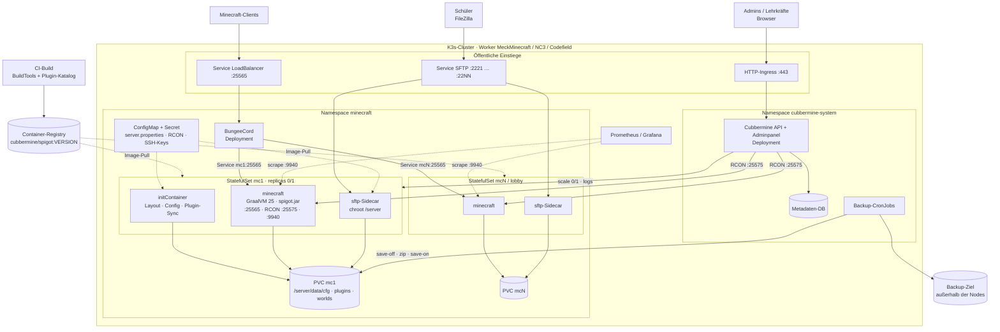
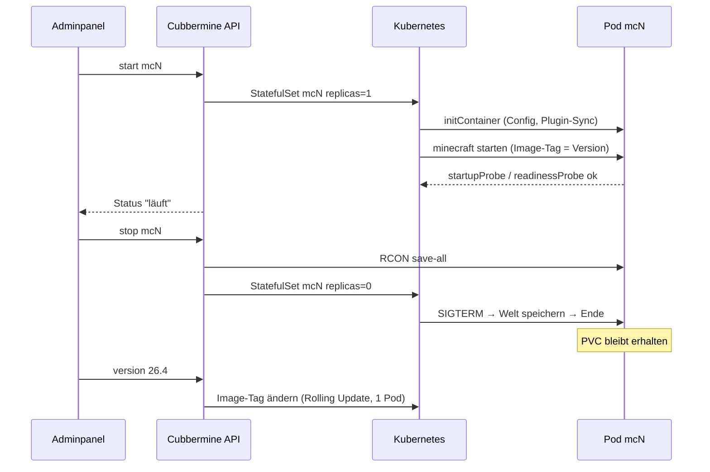

# Cubbermine – Minecraft-Container-Konzept

**Status:** Konzept (Entwurf, 16.11.2026). Grundlage für Meilenstein M2 (Minecraft-Workload-Prototyp) in [planning.md](planning.md). Es ist noch nichts davon umgesetzt.

Dieses Dokument analysiert die beiden vorhandenen Ansätze, Minecraft-Server in Docker zu betreiben, und leitet daraus ab, wie das Minecraft-Image und der Minecraft-Pod für Cubbermine (K3s, siehe [architecture.md](architecture.md)) aussehen sollen.

Untersucht wurden:

1. **minecraftHostingServer** ([github.com/cndrbrbr/minecraftHostingServer](https://github.com/cndrbrbr/minecraftHostingServer)): läuft produktiv auf MeckMinecraft (BungeeCord-Modus: bungee, lobby, mc1–mc5) und NC3 (Standalone-Modus: mc1–mc5). Untersucht auf Stand `2131c89`.
2. **theDocks / mcserverdockB** ([minecraft/mcserverdockB/Dockerfile](https://github.com/cndrbrbr/theDocks/blob/main/minecraft/mcserverdockB/Dockerfile)): ein älterer, schlanker Ansatz von 2025. Letzte Änderung `b040bb2` (06.04.2025).

---

## 1. Analyse: minecraftHostingServer

### 1.1 Aufbau

Ein Generator-Skript (`setup.sh`) schreibt aus wenigen Parametern (Modus, Anzahl Server, Domain, SMTP) die komplette `docker-compose.yml`, `servers.json`, BungeeCord-Konfiguration und SSH-Schlüssel. Hostspezifisches steht in einer `docker-compose.override.yml`, die Re-Runs übersteht.

| Container | Image | Aufgabe | Nach außen |
|---|---|---|---|
| `mc1` … `mcN` | `spigot/Dockerfile` (eigenes Image, für alle Server gleich) | Spigot-Server **plus** SSH-Server in einem Container | Standalone: Minecraft `25564+N`; immer SSH `2220+N`, Prometheus `9940+N` |
| `bungee` | `bungee/Dockerfile` | BungeeCord-Proxy, Mojang-Authentifizierung, `ip_forward` | `25565` (nur BungeeCord-Modus) |
| `lobby` | wie `mcN` | Einstiegswelt | nur intern |
| `adminpanel` | `adminpanel/Dockerfile` (Python 3.12) | Weboberfläche: Start/Stopp, Plugins, Spieler, Login per E-Mail-Code | über Caddy (HTTPS) |
| `caddy` / `mailpit` | optional | HTTPS bzw. Mail-Testmodus | 80/443 |

Alle Container hängen am Bridge-Netz `workshop`; Daten liegen pro Server in einem eigenen Named Volume (`mcN_data` → `/server`).

### 1.2 Das Spigot-Image im Detail

- **Multi-Stage-Build:** Stufe 1 holt das GraalVM-Community-JDK 25 aus `ghcr.io/graalvm/jdk-community:25`, Stufe 2 ist `debian:trixie-slim`. GraalVM ist Pflicht, weil das Plugin *script4kids* JavaScript über die GraalVM-Polyglot-Engine ausführt; mit OpenJDK startet die JS-Engine nicht.
- **BuildTools zur Laufzeit:** Das Image enthält nur `BuildTools.jar`. Die Spigot-Jar wird **beim ersten Start im Container** für die gewünschte Version gebaut (5–10 Minuten) und als `spigot-<version>.jar` auf dem Volume abgelegt. Ein Versionswechsel (`version 26.3`) baut beim nächsten Start neu.
- **Plugin-Katalog im Image:** `fetch-catalog.sh` lädt beim Image-Build alle freigegebenen Plugins (script4kids, BlockWatch, Multiverse, WorldEdit/WorldGuard, ViaVersion, CoreProtect, BedWars, …; je Minecraft-Version eine passende Jar). `mc-plugins.sh sync` installiert vor jedem Start daraus – ohne Internetzugriff zur Laufzeit.
- **Prozessmodell:** `entrypoint.sh` läuft als PID 1 (root) und ist ein kleiner Supervisor:
  1. erzeugt SSH-Hostkeys (auf dem Volume), schreibt `authorized_keys` aus Umgebungsvariablen, startet `sshd`;
  2. legt Konfiguration beim ersten Start an (`data/cfg/server.properties`, `spigot.yml`), setzt `online-mode`/`bungeecord` passend zum Modus, setzt ein zufälliges RCON-Passwort;
  3. startet Java in einer **Endlosschleife** als Benutzer `mc-sftp` (`setpriv`), Neustart nach Absturz nach 5 s;
  4. Steuerung über Markerdateien: `.stopped` = vom Schüler gestoppt (Container läuft weiter, Java nicht), `.shutdown` = `docker stop`; SIGTERM wird an Java weitergereicht, damit die Welt gespeichert wird (`stop_grace_period: 60s`).
- **Dateilayout auf dem Volume:** `/server/data/cfg`, `/server/data/plugins`, `/server/data/worlds`, daneben Jar, Logs, `whitelist.json`, `ops.json`. Java wird mit `--config`, `--plugins`, `--world-dir` usw. auf diese Pfade gelenkt.
- **Zwei Servertypen:** `spigot` (verwaltet, s. o.) und `custom` (Schüler lädt z. B. Forge selbst hoch und liefert ein `start.sh`; nur Start/Stopp, kein Versions-/Plugin-Management).
- **Monitoring:** Prometheus-Exporter-Plugin auf Port 9940; für Forge übersetzt `metrics-adapter.py` die Metriken des Forge-Mods auf dasselbe Format.

### 1.3 Zugriff und Sicherheitsmodell

Jeder Server-Container enthält einen eigenen SSH-Server mit genau zwei Benutzern:

| Benutzer | Werkzeug | Rechte |
|---|---|---|
| `mc-sftp` | FileZilla | nur SFTP, chroot auf `/sftp`; das Volume ist dort ein zweites Mal als `/sftp/server` eingehängt |
| `mc-ctrl` | nur noch das Adminpanel (intern) | `ForceCommand /mc-dispatch.sh`: nur `start`, `stop`, `status`, `version`, `restore`, `adduser`, `plugins`, `players`, `wipe`, `properties-*` (per `sudo` auf genau diese Skripte) |

**Heutige Nutzung:** Schüler und Lehrkräfte verwalten ihre Server über die **Weboberfläche (Adminpanel)**: Start/Stopp, Plugins, Spieler, Einstellungen. PuTTY wird dafür nicht mehr genutzt. **FileZilla (SFTP) ist weiterhin im Einsatz**, um Dateien direkt auf den Server zu laden oder zu bearbeiten. Der `mc-ctrl`-Zugang besteht technisch noch, dient aber nur noch dem Adminpanel als interner Steuerweg.

Das **Adminpanel hat keinen Zugriff auf den Docker-Socket**. Es steuert die Server über SSH mit den Schlüsseln des jeweiligen Servers (`mc-ctrl` für Befehle, `mc-sftp` für Uploads) bzw. über RCON innerhalb des Containers. Eine Lücke im Adminpanel gibt damit nicht mehr Rechte, als ein Schüler über seinen eigenen Server ohnehin hat. Das ist der wichtigste Designgrundsatz des Projekts und soll erhalten bleiben.

### 1.4 Stärken und Schwächen für Kubernetes

| Stärken (übernehmen) | Schwächen (für K3s ändern) |
|---|---|
| Ein Image für alle Server, Unterschiede nur über Umgebungsvariablen | Spigot wird zur Laufzeit gebaut: der erste Start eines Pods dauert 5–10 Minuten, braucht Internet und viel RAM/CPU; ein neu geplanter Pod auf einem anderen Node ohne Volume baut erneut |
| Saubere Signalbehandlung, Welt wird beim Stopp gespeichert | Mehrere Dienste in einem Container (sshd, Java, Watcher, Metrics-Adapter), PID 1 ist ein Bash-Supervisor; Kubernetes sieht Abstürze von Java nicht |
| Plugin-Katalog im Image, keine Internetabhängigkeit beim Start | „Gestoppt“ heißt: Container läuft, Java nicht – Kubernetes-Status und tatsächlicher Zustand weichen ab, RAM-Reservierung bleibt bestehen |
| Kein Docker-Socket für die Verwaltung, Rechte = Schülerrechte | Container startet als root (chown, sshd), Schreibzugriff des Schülers auf alles inkl. Jar |
| Klare Datenaufteilung `cfg` / `plugins` / `worlds`, darauf baut `backup.sh` auf | Konfiguration und Schlüssel über Umgebungsvariablen und `.env`; Ports pro Server fest im Host-Portraum (`2220+N`, `9940+N`) |
| `custom`-Typ für Forge & Co. ohne Sonderimages | BungeeCord löst Backend-Namen nur beim Start auf; nach Neuanlage der Server landen Spieler auf dem falschen Server (bekanntes Problem, Workaround `depends_on: restart`) |

---

## 2. Analyse: theDocks / mcserverdockB

```dockerfile
FROM java17mc
ARG MC_VERSION=1.21
...
VOLUME ${WORLD_DIR}
VOLUME ${PLUGIN_DIR}
RUN wget .../BuildTools.jar && java -jar BuildTools.jar --rev $MC_VERSION
RUN apt-get remove -y git wget && rm -rf /var/lib/apt/lists/*
RUN groupadd -g 2000 ... && useradd -u 2000 ...
USER ${UID}:${GID}
COPY minecraft.jar .
COPY docker-entrypoint.sh .
ENTRYPOINT ["./docker-entrypoint.sh"]
```

### 2.1 Idee

- **Spigot wird beim Image-Build gebaut** (`--build-arg MC_VERSION=…`). Das fertige Image enthält den lauffähigen Server; der Container startet sofort.
- **Läuft als unprivilegierter Benutzer** (`USER 2000:2000`), kein root zur Laufzeit.
- **Trennung von Programm und Daten:** Welt (`/world`) und Plugins (`/plugins`) sind eigene Volumes, alles andere ist Teil des Images.
- **Exec-Form des Entrypoints**, damit Signale (`docker stop`) direkt beim Server ankommen; RAM-Limit kommt als Umgebungsvariable (`MEM_LIMIT`).
- Bewusst minimal: kein SSH, kein Adminpanel, keine Plugin-Verwaltung.

### 2.2 Befunde

- **Nicht für sich baubar:** `minecraft.jar` und `docker-entrypoint.sh` werden kopiert, liegen aber nirgends im Repository. Das Basisimage `java17mc` (bzw. dessen Basis `java17`) existiert nur lokal und muss vorher gebaut werden. Dass ein Image dieses Namens bereits besteht, ist nicht nachgewiesen.
- **Irreführender Name:** `java17` installiert tatsächlich `openjdk-21-jdk`; deshalb funktioniert `MC_VERSION=1.21` (benötigt Java 21). Für aktuelle Versionen (26.x) reicht das nicht mehr, dafür ist Java 25 nötig.
- **Build-Reste im Image:** BuildTools klont und kompiliert CraftBukkit/Spigot im Arbeitsverzeichnis; Quellen, Maven-Cache und Zwischenstände (mehrere hundert MB) bleiben im Image-Layer. `apt-get remove` in einem späteren `RUN` macht das Image nicht kleiner.
- **Unklare Jar-Herkunft:** BuildTools erzeugt `spigot-<version>.jar`; gestartet wird aber offenbar das kopierte `minecraft.jar`. Welche Jar tatsächlich läuft, ist ohne das Entrypoint-Skript nicht nachvollziehbar.
- **Sicherheit Basisimage:** `java17` setzt ein Klartextpasswort als `ARG PW` für den Benutzer `mint`. Build-Argumente stehen in der Image-Historie (`docker history`).
- **`VOLUME` im Dockerfile** erzeugt bei jedem Start ohne explizites Mount anonyme Volumes; in Kubernetes ist das wirkungslos (dort entscheidet das Pod-Manifest).
- EULA-Zeile ist auskommentiert; `gosu` wird installiert, aber nicht verwendet (der Container läuft bereits als `USER`).

### 2.3 Einordnung

mcserverdockB ist kein lauffähiges Artefakt, aber der Grundgedanke passt besser zu Kubernetes als der Laufzeit-Build von minecraftHostingServer: **ein unveränderliches, versioniertes Image pro Minecraft-Version, das als Nicht-root sofort startet, mit Daten ausschließlich auf Volumes.**

---

## 3. Vergleich

| Kriterium | minecraftHostingServer | mcserverdockB | Cubbermine (Ziel) |
|---|---|---|---|
| Spigot-Build | zur Laufzeit im Container, auf Volume gecacht | beim Image-Build | **beim Image-Build in CI**, ein Image-Tag je Version |
| Startzeit erster Start | 5–10 min + Weltgenerierung | Sekunden + Weltgenerierung | Sekunden + Weltgenerierung |
| JDK | GraalVM CE 25 | OpenJDK 21 | **GraalVM CE 25** (script4kids) |
| Laufzeitbenutzer | root (Java als `mc-sftp`) | UID 2000 | **UID 2001**, `runAsNonRoot` |
| Prozesse im Container | sshd, Java-Schleife, Watcher, Adapter | Java | **Java als PID 1**; SFTP/Metrik-Adapter als eigene Container im Pod |
| Start/Stopp | Markerdatei, Container läuft weiter | Container-Lebenszyklus | **`replicas: 1/0`** über die Cubbermine API |
| Plugins | Katalog im Image, Sync vor Start | Volume | Katalog im Image, Sync im **initContainer** |
| Konfiguration | `.env` + Kopie beim ersten Start + Watcher | Build-Args/Env | **ConfigMap + Secret**, angewendet im initContainer |
| Schülerzugang | Weboberfläche (Adminpanel) + FileZilla (SFTP im Container); SSH-Befehle nur noch intern fürs Adminpanel | – | Weboberfläche über die API + **SFTP-Sidecar** für FileZilla |
| Verwaltung | SSH als Schüler, RCON | – | **RCON über internen Service**, NetworkPolicy nur für die API |
| Daten | Named Volume `/server` | anonyme Volumes `/world`, `/plugins` | **PVC je Server**, Layout `/server/data/{cfg,plugins,worlds}` bleibt |
| Proxy | BungeeCord (Container-IPs zum Startzeitpunkt) | – | BungeeCord (später Velocity prüfen) über **stabile Service-Namen** |

---

## 4. Konzept für Cubbermine

### 4.1 Grundsätze

1. **Ein Image, unveränderlich und versioniert.** Spigot wird in der CI gebaut, nicht im Cluster. Das Image heißt z. B. `registry/cubbermine/spigot:26.3-graal25-<build>`; die Minecraft-Version eines Servers ist damit gleich dem Image-Tag. Ein Versionswechsel ist ein Wechsel des Tags im StatefulSet (Rollback = alter Tag).
2. **Ein Prozess pro Container.** Java läuft als PID 1 (Start über `exec`, optional `tini`), damit Kubernetes Abstürze, Neustarts und Probes direkt sieht. Die eigene Neustartschleife entfällt (`restartPolicy: Always` übernimmt).
3. **Stoppen heißt Herunterskalieren.** „Stop“ setzt das StatefulSet auf `replicas: 0`; der Pod verschwindet, RAM wird frei, das PVC bleibt. „Start“ setzt `replicas: 1`. Markerdateien (`.stopped`, `.shutdown`) werden nicht mehr gebraucht.
4. **Schülerrechte bleiben das Maß.** Wie bisher bekommt weder Adminpanel noch Schüler Zugriff auf den Docker-Socket bzw. die Kubernetes-API mit Schreibrechten auf fremde Ressourcen. Die Cubbermine API hat nur die Rechte, die sie für die eigenen Minecraft-Ressourcen braucht (RBAC je Namespace).
5. **Daten nur auf dem PVC.** Alles, was nicht auf dem PVC liegt, kommt aus dem Image oder aus ConfigMap/Secret und darf jederzeit verloren gehen.
6. **Kompatibles Datenlayout.** Das Volume-Layout von minecraftHostingServer (`/server/data/cfg|plugins|worlds`, `whitelist.json`, `ops.json` im Root) bleibt unverändert, damit Welten 1:1 migriert werden können und `backup.sh`/`restore` weiter passen.

### 4.2 Images

| Image | Inhalt | Gebaut aus |
|---|---|---|
| `cubbermine/spigot:<mc-version>-<build>` | GraalVM CE 25 (Laufzeit), fertige `spigot.jar`, Plugin-Katalog (alle Jars für diese Version), Standardkonfiguration, `cubbermine-init.sh` | Multi-Stage-Build, s. u. |
| `cubbermine/custom-runtime:<java>` | nur JDK + Start-Wrapper, der `/server/start.sh` ausführt (Ersatz für `MC_SERVER_TYPE=custom`, z. B. Forge) | einfaches Dockerfile |
| `cubbermine/sftp:<build>` | OpenSSH nur mit `internal-sftp`, chroot, ein Benutzer | aus `spigot/sshd_config` abgeleitet |
| `cubbermine/bungee:<build>` | BungeeCord, Konfiguration aus ConfigMap | `bungee/Dockerfile` |
| `cubbermine/metrics-adapter` | `metrics-adapter.py` für Forge-Server | aus minecraftHostingServer |

Skizze des Spigot-Images (übernimmt die Build-Idee aus mcserverdockB und Basis/JDK/Katalog aus minecraftHostingServer):

```dockerfile
# Stufe 1: Spigot bauen (Build-Reste bleiben in dieser Stufe)
FROM ghcr.io/graalvm/jdk-community:25 AS build
ARG MC_VERSION
RUN microdnf install -y git && \
    curl -fsSL -o /tmp/BuildTools.jar https://hub.spigotmc.org/jenkins/job/BuildTools/lastSuccessfulBuild/artifact/target/BuildTools.jar && \
    cd /tmp && java -jar BuildTools.jar --rev "$MC_VERSION" --compile SPIGOT && \
    cp /tmp/spigot-*.jar /spigot.jar && \
    cp -r "$JAVA_HOME" /opt/graalvm-jdk

# Stufe 2: Plugin-Katalog für genau diese Version laden
# (fetch-catalog.sh lädt heute alle Versionen; Filter auf MC_VERSION wäre neu)
FROM debian:trixie-slim AS catalog
ARG MC_VERSION
COPY plugin-catalog.json fetch-catalog.sh /src/
RUN apt-get update && apt-get install -y curl jq && /src/fetch-catalog.sh /src/plugin-catalog.json /catalog "$MC_VERSION"

# Stufe 3: Laufzeit
FROM debian:trixie-slim
COPY --from=build /opt/graalvm-jdk /opt/graalvm
ENV JAVA_HOME=/opt/graalvm PATH=/opt/graalvm/bin:$PATH
RUN groupadd -g 2001 mc && useradd -u 2001 -g mc -M -s /usr/sbin/nologin mc
COPY --from=build   /spigot.jar /opt/minecraft/spigot.jar
COPY --from=catalog /catalog    /opt/minecraft/catalog
COPY defaults/ /opt/minecraft/defaults/          # server.properties, spigot.yml, eula.txt
COPY cubbermine-init.sh cubbermine-run.sh /usr/local/bin/
USER 2001:2001
WORKDIR /server
ENTRYPOINT ["/usr/local/bin/cubbermine-run.sh"]   # endet mit: exec java ... -jar /opt/minecraft/spigot.jar
```

Wichtig: Die Jar liegt im Image (`/opt/minecraft`), **nicht** mehr auf dem Volume. Schüler können sie dadurch nicht mehr austauschen; wer eine eigene Server-Software will, bekommt den `custom`-Typ.

### 4.3 Pod je Minecraft-Server

Jeder Server ist ein `StatefulSet` mit `replicas: 0|1` und einem eigenen PVC (aus `volumeClaimTemplates`). Der Pod besteht aus:

| Container | Art | Aufgabe |
|---|---|---|
| `init` | initContainer, Image `cubbermine/spigot` | legt das Layout auf dem PVC an, kopiert Standardkonfiguration beim ersten Start, wendet ConfigMap-Werte (`server.properties`-Overrides, `online-mode`, `bungeecord`) und das RCON-Passwort aus dem Secret an, synchronisiert Plugins aus dem Katalog (heutiges `mc-plugins.sh sync`) |
| `minecraft` | Hauptcontainer | `exec java -Xms… -Xmx… -jar /opt/minecraft/spigot.jar --config ./data/cfg/server.properties … --world-dir ./data/worlds nogui`; Ports 25565 (Spiel), 25575 (RCON, nur intern), 9940 (Metriken) |
| `sftp` | Sidecar (optional pro Server) | FileZilla-Zugang des Schülers wie bisher: chroot, nur SFTP, Schlüssel aus Secret; hängt dasselbe PVC ein |
| `metrics-adapter` | Sidecar, nur Typ `custom`/Forge | übersetzt Forge-Metriken auf Port 9940 |

Einstellungen im Pod:

- `securityContext`: `runAsUser/runAsGroup/fsGroup: 2001`, `runAsNonRoot: true`, `allowPrivilegeEscalation: false`, Capabilities `drop: [ALL]`. Der SFTP-Sidecar braucht für den chroot root bzw. `SYS_CHROOT` – das bleibt auf diesen Container beschränkt.
- `terminationGracePeriodSeconds: 90`; Java bekommt SIGTERM direkt und speichert die Welt. Zusätzlich ein `preStop`-Hook, der per RCON `save-all` und `stop` auslöst.
- Probes: `startupProbe` (TCP 25565, großzügig, Weltgenerierung dauert), `readinessProbe` (RCON `list` bzw. TCP), `livenessProbe` nur zurückhaltend (sonst Neustart mitten im Speichern).
- Ressourcen: `requests.memory` = Xmx + Overhead, `limits.memory` = Xmx × ca. 1,3 (Java braucht Metaspace, Threads, Netty-Puffer und bei GraalVM die JS-Engine außerhalb des Heaps). Heutiger Wert NC3: Xmx 3840 MiB → Limit ca. 5 GiB. Die genauen Werte sind im Pilot zu messen.
- `priorityClassName: minecraft` (hohe Priorität): Minecraft-Pods gehen vor Nebendiensten wie der KI (Ollama) auf NC3, siehe [websites-monitoring.md](websites-monitoring.md), Abschnitt 3.3.
- `nodeAffinity`/`nodeSelector` für Server mit lokalem Speicher (siehe 4.6); Toleration so, dass nichts auf der Control Plane landet.

### 4.4 Netzwerk und Zugang

- **Spieler:** ein öffentlicher Einstieg auf Port 25565 (BungeeCord als `Deployment` mit `Service` vom Typ `LoadBalancer` über K3s ServiceLB oder `hostPort` auf einem festen Node). Die Backends haben nur `ClusterIP`-Services (`mc1.minecraft.svc`). Weil Service-Namen eine stabile IP haben, entfällt das heutige Problem, dass BungeeCord nach Neuanlage der Server zu falschen Containern routet.
- **Server, die heute eigene Ports haben** (NC3 Standalone, 25565–25569): für die Übergangszeit eigene `LoadBalancer`-/NodePort-Services mit denselben Ports, damit sich für die Spieler nichts ändert. Langfristig alle hinter den Proxy.
- **SFTP:** pro Server ein TCP-Service auf den Sidecar mit dem bisherigen Port `2220+N`, damit vorhandene Schülerschlüssel und FileZilla-Profile weiter gelten. Der Dienst ist nicht HTTP und läuft daher nicht über den Ingress.
- **Verwaltung:** Die Cubbermine API spricht mit den Servern über **RCON** auf dem internen Service (Passwort aus Secret) und über die Kubernetes-API (nur `scale`/`get`/`logs` auf StatefulSets und Pods im eigenen Namespace). Eine `NetworkPolicy` erlaubt Port 25575 nur aus dem API-Pod und Port 25565 nur aus dem Proxy. Das ersetzt den internen `mc-ctrl`-Weg des Adminpanels über SSH (PuTTY wird schon heute nicht mehr genutzt, ein SSH-Befehlszugang für Schüler ist daher nicht nötig); die Befehle `start`, `stop`, `status`, `version`, `restore`, `adduser`, `plugins`, `players`, `wipe`, `properties` werden zu API-Endpunkten.
- **Weboberflächen** (Adminpanel, BlueMap auf Port 8100): HTTP-Ingress (Traefik aus K3s oder Caddy), getrennt vom Minecraft-TCP-Verkehr.

### 4.5 Konfiguration und Geheimnisse

| Heute | Cubbermine |
|---|---|
| `.env`: `MCn_SFTP_PUBKEY`, `MCn_CTRL_PUBKEY` | Secret `mcN-sftp` (authorized_keys, FileZilla-Zugang bleibt); der Ctrl-Schlüssel wird nur noch vom Adminpanel genutzt und entfällt mit der API |
| `.rcon-password` auf dem Volume, im Container erzeugt | Secret `mcN-rcon`, von der API erzeugt |
| Umgebungsvariablen `MC_MEM_*`, `MC_LEVELNAME`, `MC_SERVER_TYPE`, `MC_BUNGEECORD` | Felder der Cubbermine-Serverdefinition → StatefulSet-Env + ConfigMap |
| `server.properties` aus dem Image, `watch_copy.sh` überträgt Änderungen | Standardwerte im Image, Overrides als ConfigMap; Anwendung im initContainer bei jedem Start |
| `BACKUP_URL` | Backup-Ziel als Secret/ConfigMap des Backup-Jobs |

### 4.6 Speicher und Backup

- **PVC je Server** mit dem bisherigen Layout. Für den Pilot reicht `local-path` (K3s-Standard): schnell, aber an einen Node gebunden; fällt der Node aus, startet der Server erst wieder, wenn der Node zurück ist oder die Welt aus dem Backup wiederhergestellt wird. Netzwerkspeicher (z. B. Longhorn) ist eine spätere Entscheidung (siehe [architecture.md](architecture.md), offene Punkte 3) und hängt von Durchsatz und Latenz ab; die Messungen in [PreNetzwerkmessung.md](PreNetzwerkmessung.md) (1 Gbit/s, ~0,5 ms) machen es möglich, aber nicht kostenlos.
- **Backup** als `CronJob` je Server bzw. als Job, den die API auslöst: RCON `save-off` + `save-all flush`, dann `cfg`/`plugins`/`worlds` als ZIP (gleiches Format wie `backup.sh`, damit `restore` weiter funktioniert), Upload auf ein Ziel außerhalb des Nodes, danach `save-on`. Der Job muss auf demselben Node laufen wie der Pod (RWO-Volume).
- **Restore** = Server auf `replicas: 0`, Restore-Job entpackt in das PVC, `replicas: 1`. Ausgelöst wird er künftig in der **Weboberfläche** (heute nur per Steuerbefehl `restore`): Backup aus der Archivliste wählen, ganz oder nur Welten/Plugins/Konfiguration; die API sichert vorher den aktuellen Stand und prüft, dass das Backup nicht von einer neueren Minecraft-Version stammt.
- **Archiv:** Welt-Backups und alle produktiv genutzten Images werden außerhalb der Worker-Nodes archiviert (Aufbewahrung, Prüfsummen, Restore-Tests). Die Aufgaben dazu stehen in [planning.md](planning.md), M2.
- **Kein Doppelzugriff:** StatefulSet mit genau einem Replica und RWO-PVC; die Migration (Abschnitt 5) muss sicherstellen, dass Compose- und K3s-Server nie gleichzeitig dieselbe Welt schreiben.

### 4.7 Monitoring

- Prometheus-Exporter-Plugin wie bisher auf Port 9940, im Cluster per `ServiceMonitor` oder Scrape-Annotations erfasst. Metrik- und Label-Namen (`server_name`) bleiben gleich, damit die bestehenden Grafana-Dashboards und Discord-Alerts weiter funktionieren.
- Logs gehen nach stdout (Java als PID 1); `latest.log` bleibt zusätzlich auf dem PVC, weil Schüler und Adminpanel ihn lesen.

---

## 5. Architektur-Diagramm



Lebenszyklus eines Servers über die API:



---

## 6. Abbildung Compose → Kubernetes

| minecraftHostingServer | Cubbermine |
|---|---|
| `setup.sh` erzeugt `docker-compose.yml` | Cubbermine API erzeugt StatefulSet, Services, PVC, ConfigMap, Secret (idempotent) |
| Service `mcN` (`build: ./spigot`) | `StatefulSet mcN` mit Image `cubbermine/spigot:<version>` |
| Volume `mcN_data` → `/server` (+ `/sftp/server`) | PVC `data-mcN-0` → `/server` im Minecraft- und SFTP-Container |
| `ports: 2220+N:22` | Service für den SFTP-Sidecar, gleicher Port |
| `ports: 9940+N:9940` | kein Host-Port, Scrape im Cluster |
| `ports: 25564+N:25565` (Standalone) | Übergang: LoadBalancer-Service je Server; Ziel: nur über Proxy |
| `stop_grace_period: 60s` | `terminationGracePeriodSeconds: 90` + `preStop` |
| `restart: unless-stopped` + Bash-Schleife | `restartPolicy: Always` (Pod) |
| `mc-ctrl` + `mc-dispatch.sh` (nur noch vom Adminpanel genutzt, PuTTY entfallen) | API-Endpunkte (RCON + Kubernetes-API) |
| `version <x>` (BuildTools auf dem Volume) | Image-Tag wechseln |
| `restore <datum>` (`mc-restore.sh`, `BACKUP_URL`; nicht in der Weboberfläche) | Restore-Job der API, ausgelöst über die Weboberfläche |
| `MC_SERVER_TYPE=custom` | Image `cubbermine/custom-runtime`, `start.sh` vom PVC |
| `adminpanel` mit Schlüsseln aus `keys/` | Cubbermine API mit ServiceAccount (RBAC) und RCON-Secrets |
| `bungee` mit `depends_on: restart` | BungeeCord-Deployment, Backends über Service-DNS |

## 7. Migrationsschritte

1. **Image-Pipeline:** Spigot-Image für 26.3 in CI bauen (inkl. Plugin-Katalog), in eine Registry (z. B. GHCR) pushen. Lokal mit einer Kopie eines `mcN_data`-Volumes starten und prüfen, dass Welt, Plugins, Whitelist und Ops unverändert übernommen werden.
2. **Pilot (M2):** ein nichtkritischer Server als StatefulSet mit `local-path`-PVC, initContainer und SFTP-Sidecar; Proxy-Anbindung, Start/Stopp per Skalierung, Backup + Restore einer Testwelt, Pod-Neustart ohne Datenverlust.
3. **API-Anbindung (M3):** Befehle des Dispatchers nacheinander als API-Endpunkte; die Weboberfläche (Adminpanel) auf die API umstellen. Für Nutzer ändert sich dabei nichts, weil sie schon heute nur die Weboberfläche und FileZilla verwenden.
4. **Umzug je Server (M4):** Wartungsfenster → Compose-Server stoppen → Backup → Restore in das PVC → K3s-Server starten → Test → DNS/Port umschalten. Der Compose-Container bleibt gestoppt (nicht gelöscht) bis zur Abnahme; Rückfall = K3s auf `replicas: 0`, Compose wieder starten.
5. **Proxy und Lobby zuletzt**, wenn alle Backends im Cluster laufen.

## 8. Offene Entscheidungen

1. **Container-Registry und Archiv:** GHCR (öffentlich/privat) oder eigene Registry; Zugangsdaten als `imagePullSecret`. Dazu der Archivspeicher für Images (OCI-Archive) und Welt-Backups außerhalb der Nodes (siehe [planning.md](planning.md), M2).
2. **Version pro Image oder pro Server:** Ein Image-Tag je Minecraft-Version deckt Spigot ab. Schüler, die heute frei per `version` beliebige Versionen bauen, bekommen nur noch eine freigegebene Liste – ist das gewollt?
3. **SFTP-Sidecar vs. zentraler SFTP-Dienst:** Sidecar ist einfach und hält das bisherige Modell, kostet aber einen öffentlichen Port je Server. Ein zentraler Dienst (z. B. SFTPGo) bräuchte Zugriff auf alle PVCs – mit RWO-Volumes auf verschiedenen Nodes ist das schwierig.
4. **Schreibrecht auf die Jar:** Bisher kann der Schüler alles in `/server` ändern; im Konzept liegt die Jar schreibgeschützt im Image. Für Ausnahmen bleibt der `custom`-Typ.
5. **Storage:** `local-path` (Bindung an Node) oder Netzwerkspeicher; davon hängt ab, ob ein Server bei Node-Ausfall automatisch woanders starten kann.
6. **BungeeCord oder Velocity** für den neuen Proxy (Velocity hat modernes Forwarding, braucht aber Paper statt Spigot für volle Unterstützung).
7. **Codefield:** Der Server dort läuft aus dem Repo javascriptMinecraftWorkshopServer mit eigener Compose-Datei. Er sollte vor der Migration auf dasselbe Image umgestellt werden.

Siehe auch [architecture.md](architecture.md), [features.md](features.md), [planning.md](planning.md).
