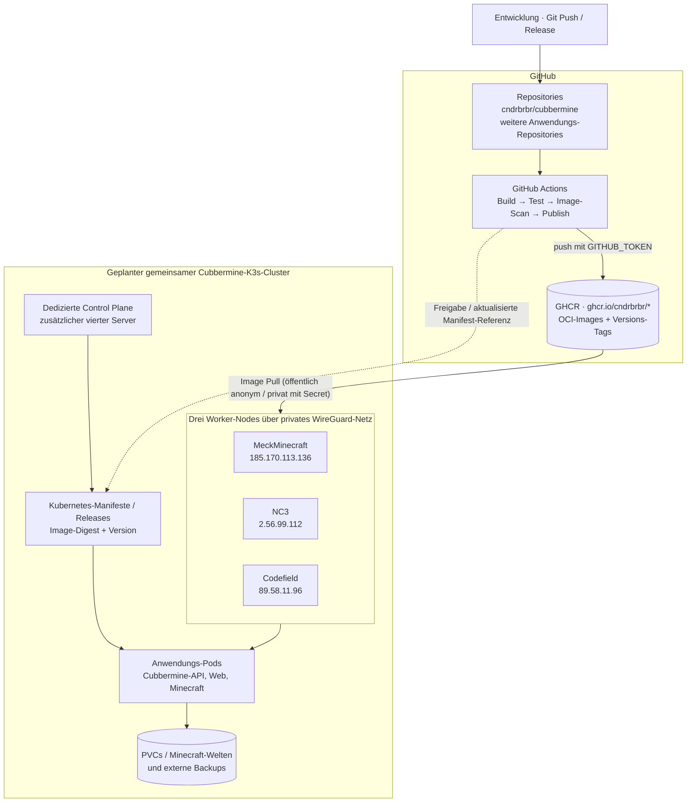

# Cubbermine – Container-Registry-Konzept (GHCR)

**Status:** Konzept / geplante Umsetzung · **Stand:** 16.11.2026  
**Projekt:** [Cubbermine](README.md) · Architektur: [architecture.md](architecture.md) · Planung: [planning.md](planning.md)

## 1. Ziel und Entscheidung

Für die selbst entwickelten Anwendungen von Cubbermine wird **GitHub Container Registry (GHCR)** unter `ghcr.io` als zentrale Registry für Docker-/OCI-Images vorgesehen. Quellcode liegt in GitHub-Repositories; **GitHub Actions** baut, testet und veröffentlicht versionierte Images; **K3s/Kubernetes** lädt diese Images auf die Worker-Nodes.

Dadurch werden **Quellcode**, **gebautes Container-Image** und **laufende Serverinstanz** voneinander getrennt:

- **GitHub Repository**: Quellcode, Dockerfile, Workflow, Kubernetes-Manifeste.
- **GitHub Actions (CI)**: Kompilieren, Tests, Image bauen, Sicherheitschecks, Image veröffentlichen.
- **GHCR**: Versionierte, reproduzierbar abrufbare Container-Images.
- **K3s**: Starten/Aktualisieren der Pods über deklarative Deployments/StatefulSets.
- **PVCs/Backups**: Minecraft-Welten, Plugin-Daten, Konfiguration und andere langlebige Nutzerdaten; **nicht** in GHCR.

**Aktueller Stand:** Das ist eine Zielkonzeption; es wird damit **nicht** behauptet, dass Cubbermine-Images, Workflows oder ein K3s-Cluster bereits eingerichtet sind.

## 2. Architekturübersicht



**Wichtig:** Das Diagramm zeigt die geplanten Datenflüsse, nicht die physische Netzwerkverkabelung. Die **Control Plane** steuert Kubernetes; sie ist **kein Image-Proxy**. Images werden durch die Container-Runtime auf den **Worker-Nodes** aus der Registry geladen. Der bestehende Adminpanel-Ansatz wird in Cubbermine zu einer gemeinsamen Verwaltungsoberfläche weiterentwickelt (siehe [architecture.md](architecture.md)).

## 3. Vorgesehene Images und Namensschema

**Beispielnamen; diese Images sind nicht als bereits veröffentlicht zu verstehen:**

| Image | Zweck |
| --- | --- |
| `ghcr.io/cndrbrbr/cubbermine-api:1.0.0` | Zentrale Verwaltungs-API / Controller |
| `ghcr.io/cndrbrbr/cubbermine-web:1.0.0` | Weboberfläche |
| `ghcr.io/cndrbrbr/minecraft-paper:1.0.0` | Optional eigenes Minecraft-Server-Basisimage |
| `ghcr.io/cndrbrbr/javascript-workshop:1.0.0` | Optionales Workshop-Image |

Nicht jedes Minecraft-Image muss selbst gebaut werden: Bewährte Fremdimages können **bewusst versioniert** aus anderen Registries verwendet werden. Selbst entwickelte Plugins können über einen separaten Build-Prozess als JAR erstellt und kontrolliert in eine Minecraft-Instanz eingebracht werden. **Welt- und Spieldaten werden niemals im Image gespeichert.**

**Tagging-Konvention:**
- Versions-Releases: `1.0.0`, `1.1.0` (unveränderlich behandeln).
- Entwicklung: `dev-<kurzer-commit-sha>` (nur Testumgebung).
- Optional `latest` als Komfort-Tag, **nicht** zur produktiven Bereitstellung.
- Produktion: bevorzugt **Digest-Pinning** (`image@sha256:...`) plus dokumentierter Release-Version, um exakt getestete Inhalte zu starten.

## 4. Build- und Release-Prozess (Soll)

1. Änderung im GitHub-Repository; Pull Request mit Review und Tests.
2. GitHub Actions kompiliert Anwendung/Plugin, führt Unit-Tests und geeignete Image-Scans aus.
3. Bei versioniertem Release wird ein OCI-/Docker-Image gebaut.
4. Action authentifiziert sich mit dem kurzlebigen `GITHUB_TOKEN` und `packages: write` bei GHCR.
5. Image wird mit Version, Git-Commit und OCI-Source-Label veröffentlicht.
6. Eine kontrollierte Freigabe aktualisiert den Image-Digest im K3s-Deployment/StatefulSet (später ggf. GitOps).
7. Kubernetes lädt das neue Image auf geeignete Worker; Healthchecks und Rollback verifizieren das Ergebnis.

**Keine vollautomatischen Updates produktiver Minecraft-Instanzen ohne Rücksicht auf Weltdaten, Serverversionen und Plugin-Kompatibilität.** Vor Serverupdates sind Wartungsfenster, Backup und Rollback vorzusehen.

### GitHub Actions – Grundkonfiguration (Skizze)

Für ein Repository mit vorhandenem `Dockerfile` kann ein Workflow später beispielsweise folgende Prinzipien verwenden:

```yaml
name: Publish container
on:
  push:
    tags: ['v*']
permissions:
  contents: read
  packages: write
jobs:
  publish:
    runs-on: ubuntu-latest
    steps:
      - uses: actions/checkout@v4
      - uses: docker/login-action@v3
        with:
          registry: ghcr.io
          username: ${{ github.actor }}
          password: ${{ secrets.GITHUB_TOKEN }}
      - uses: docker/build-push-action@v6
        with:
          context: .
          push: true
          tags: ghcr.io/cndrbrbr/cubbermine-api:1.0.0
          labels: |
            org.opencontainers.image.source=https://github.com/cndrbrbr/cubbermine
```

Dies ist eine **Illustration**, kein direkt produktionsfertiger Workflow: Der fest kodierte Tag muss vor Einsatz automatisch aus dem Release abgeleitet, der Build-Kontext zum tatsächlichen Quellcode angepasst, Berechtigungen eingeschränkt und verwendete Actions-Versionen idealerweise auf geprüfte Commit-SHAs fixiert werden.

## 5. Pull und Zugriff aus Kubernetes

- **Öffentliches Image:** Kann im Regelfall ohne Registry-Anmeldung von K3s/Containerd geladen werden.
- **Privates Image:** Erfordert Registry-Zugriffsberechtigung, z. B. `imagePullSecret` im betroffenen Namespace oder eine geeignete zentral verwaltete Credential-Lösung.
- **CI-Push:** Nach Möglichkeit `GITHUB_TOKEN` des jeweiligen Repositories statt eines langfristigen Personal Access Tokens einsetzen; Package-/Repository-Berechtigungen korrekt konfigurieren.
- **Manuelles Pushen:** Wenn erforderlich, GitHub Personal Access Token (classic) mit passendem `write:packages`-Scope und minimalen nötigen Zusatzrechten verwenden, sicher speichern und nicht in Git ablegen.
- **Sicherheit:** Images vor Freigabe scannen, Basisimages aktuell halten, Secrets nicht in Images einbauen, nur freigegebene Paketversionen deployen.

Beispiel für einen späteren Kubernetes-Container:

```yaml
containers:
  - name: cubbermine-api
    image: ghcr.io/cndrbrbr/cubbermine-api:1.0.0
    imagePullPolicy: IfNotPresent
```

Eine tatsächlich reproduzierbare Produktionseinführung verwendet statt des Beispiel-Tags einen geprüften Image-Digest.

## 6. Kosten und Abrechnung

**Stand 16.11.2026:** Nach GitHubs offizieller Dokumentation sind **Image-Speicherung und Bandbreite der Container Registry derzeit kostenlos**. GitHub kündigt Änderungen dieser Regelung nach eigenen Angaben mindestens einen Monat vorher an. Ein zusätzliches GHCR-Abo ist aktuell **nicht erforderlich**.

**Abgrenzung:** Andere GitHub-Packages-Angebote können eigene Kontingente haben. GitHub Actions hat plan- und runnerabhängige Nutzungs- bzw. Abrechnungsregeln; aus „GHCR derzeit kostenlos“ folgt **nicht**, dass jeder CI-Build oder jede zusätzliche Infrastruktur kostenfrei ist. Kosten für den geplanten Control-Plane-Server, Worker und Netzwerk entstehen unabhängig davon.

Offizielle Dokumentation:
- [GitHub – Abrechnung von GitHub Packages](https://docs.github.com/en/billing/concepts/product-billing/github-packages)
- [GitHub – Container Registry](https://docs.github.com/en/packages/working-with-a-github-packages-registry/working-with-the-container-registry)
- [GitHub – Docker-Images veröffentlichen](https://docs.github.com/en/actions/tutorials/publish-packages/publish-docker-images)

## 7. Abgrenzung zu bestehenden Systemen

Die drei bestehenden Hosts verwenden aktuell **Docker Compose**. Cubbermine wird laut [architecture.md](architecture.md) als gemeinsamer K3s-Cluster mit **einer dedizierten Control Plane und drei bestehenden Worker-Nodes** geplant.

Die bereits eingesetzten Minecraft-Server und das vorhandene Adminpanel werden **nicht automatisch** durch das Einführen einer Registry migriert. GHCR stellt ausschließlich auslieferbare Images bereit. Die Migration von Container-Startparametern, Configs, Netzwerk/Proxy, SFTP-Zugriff, Minecraft-Welten, Plugins und Berechtigungen ist Bestandteil der separaten Migrationsplanung.

## 8. Umsetzungsschritte und offene Entscheidungen

- [ ] Festlegen, welche Komponenten eigene Images erhalten und welche geprüften Fremdimages nutzen.
- [ ] Dockerfiles und Build-Kontexte für API/Web/ggf. Minecraft-Images definieren.
- [ ] GHCR-Package-Sichtbarkeit und Berechtigungsmodell (öffentlich oder privat) entscheiden.
- [ ] GitHub Actions mit Tests, Scans, Tagging und OCI-Labels einrichten.
- [ ] Ersten Test-Release in GHCR veröffentlichen und vom K3s-Pilot-Worker herunterladen.
- [ ] Private-Image-Pull und Secret-Rotation testen, falls private Images vorgesehen sind.
- [ ] Digest-Pinning, Promotion zwischen Test/Produktion, Rollback und Aufbewahrung alter Versionen regeln.
- [ ] Versorgung der Worker beim Ausfall der Registry betrachten (Image-Cache hilft nur für bereits geladene Images).
- [ ] Verfügbarkeit, Limits und Kosten von GHCR und GitHub Actions regelmäßig prüfen.
- [ ] Registry-Verfahren mit [features.md](features.md) und [planning.md](planning.md) abstimmen.

**Ergebnisziel:** Ein commit- und versionsbezogenes, nachvollziehbares Release-Verfahren für Cubbermine, das Minecraft-Workloads reproduzierbar auf den drei K3s-Workern startet, ohne persistente Daten mit Images zu vermischen.
