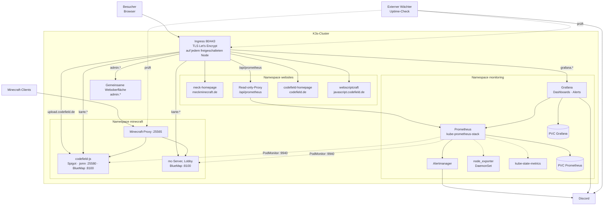

# Cubbermine – Websites und Monitoring im Cluster

**Status:** Konzept (Entwurf, 16.11.2026). Ergänzt [architecture.md](architecture.md), [dockerminecraft.md](dockerminecraft.md) und [planning.md](planning.md). Es ist noch nichts umgesetzt.

Dieses Dokument plant die Übernahme der beiden öffentlichen Websites mit ihren Begleitdiensten in den K3s-Cluster:

1. **meckminecraft.de** auf MeckMinecraft: Homepage, Server-Statusseite, Grafana-Dashboard und Prometheus (Repository [minecraftDash](https://github.com/cndrbrbr/minecraftDash)).
2. **codefield.de** auf Codefield: Homepage, JavaScript-IDE, Upload und Karte des JavaScript-Workshop-Servers (Repository [javascriptMinecraftWorkshopServer](https://github.com/cndrbrbr/javascriptMinecraftWorkshopServer)).

Omasys, NonameQuiz, Kookie (NC3) und testo2c (Codefield) sind nicht Teil dieses Dokuments; sie werden weiterhin separat bewertet.

---

## 1. Bestand

### 1.1 meckminecraft.de (MeckMinecraft, `/root/mcDashProject/minecraftDash`)

| Container | Image | Aufgabe | Erreichbar |
|---|---|---|---|
| `caddy` | `caddy:2-alpine` | HTTPS, statische Homepage aus `./homepage` (ca. 5 MB HTML/Bilder), Proxy `/api/prometheus/*` → Prometheus | `meckminecraft.de` :80/:443 |
| | | Proxy `admin.meckminecraft.de` → Adminpanel (Block von Hand ergänzt) | |
| | | Proxy `karte-inigresso.meckminecraft.de` → BlueMap in `mc2:8100` | |
| `prometheus` | `prom/prometheus` (ohne festen Tag) | sammelt alle 15 s: Minecraft-Metriken aller Server (Ports 9940–9945 auf allen drei Hosts) und node_exporter (:9100, Basic Auth) der drei Hosts | Host-Port **9090, öffentlich** |
| `grafana` | `grafana/grafana` (ohne festen Tag) | Dashboard `minecraft.json`, Datenquelle Prometheus, Alert-Regeln mit Discord-Benachrichtigung (Provisioning-Dateien) | Host-Port **3000, öffentlich, nur HTTP** |

Die Statusseite `meckminecraft.de/server.html` und die Weltansicht `welt-ansicht.html` (Links auf die BlueMaps) gehören zur Homepage. `server.html` fragt Prometheus über `/api/prometheus/` direkt aus dem Browser ab.

### 1.2 codefield.de (Codefield, `/root/javascriptMinecraftWorkshopServer` + `/root/caddy-proxy`)

| Container | Image | Aufgabe | Erreichbar |
|---|---|---|---|
| `caddy-proxy` (eigenes Compose-Projekt) | `caddy:2-alpine` | HTTPS für alle Domains auf Codefield (auch testo2c), `admin off` | :80/:443 |
| `homepage` | eigenes Image auf `nginx:trixie` | Workshop-Homepage mit Kursen; `IDE_URL`, `UPLOAD_URL`, `MC_ADDRESS` werden beim Start per `envsubst` eingesetzt | `codefield.de`, `www.codefield.de` |
| `webscriptcraft` | eigenes Image auf `nginx:trixie` | JavaScript-IDE (statisch, `/ide.html`) | `javascript.codefield.de` |
| `spigot` | eigenes Image (Debian trixie, Spigot 26.3) | Workshop-Server; Plugin *jsmn* nimmt Skript-Uploads auf Port 25580 an, BlueMap auf 8100, Prometheus-Exporter auf 9940 | Minecraft `codefield.de:25565`; `upload.codefield.de` → :25580; `karte.codefield.de` → :8100 |

Die Weltdaten liegen im Volume `javascriptminecraftworkshopserver_minecraft_data` (3,2 GB). Backups macht der mineback-Agent (Timer täglich 02:17). Der Server hat kein Adminpanel und kein RCON.

### 1.3 Befunde bei der Bestandsaufnahme

Diese Punkte sollten unabhängig von der Migration behoben werden:

| Befund | Risiko | Empfehlung |
|---|---|---|
| Prometheus ist auf Port 9090 ohne Anmeldung öffentlich erreichbar (zusätzlich zum ebenfalls öffentlichen `/api/prometheus/`) | Jeder kann alle Metriken lesen, die Admin-Oberfläche nutzen und teure Abfragen stellen | Port 9090 nicht mehr veröffentlichen; `/api/prometheus/` auf lesende Abfragen (`/api/v1/query`, `query_range`) beschränken |
| Grafana ist auf Port 3000 öffentlich, nur über HTTP | Anmeldedaten gehen unverschlüsselt über das Netz | Nur noch über Caddy mit HTTPS anbieten; das Admin-Passwort steht in der Compose-Datei als `admin` und muss geändert sein |
| Prometheus hat kein Volume für `/prometheus` | Die Messdaten (zurzeit 1 GB) gehen beim Neuanlegen des Containers verloren | Volume ergänzen |
| Images ohne festen Tag (`prom/prometheus`, `grafana/grafana`) | Ein `pull` kann unbemerkt auf eine neue Hauptversion springen | Versionen festschreiben |
| Viele lokale, nicht eingecheckte Änderungen im minecraftDash-Repository auf MeckMinecraft (Homepage-Seiten, Caddyfile, Compose-Datei) | Die Homepage lässt sich aus Git nicht wiederherstellen und nicht als Image bauen | Vor der Migration einchecken |

---

## 2. Zielbild

Grundsätze:

- **Websites sind zustandslos.** Homepage, IDE und Statusseite werden zu Images (nginx mit den statischen Dateien), gebaut in der CI aus Git und archiviert wie die Minecraft-Images (siehe [planning.md](planning.md), M2). Ein Content-Update heißt: neues Image, neuer Tag.
- **Ein HTTP-Einstieg für alle Domains.** Der Ingress-Controller (Traefik aus K3s oder ein Caddy-/nginx-Ingress) ersetzt die drei Caddy-Instanzen; TLS-Zertifikate von Let's Encrypt über cert-manager oder den Ingress-Controller selbst.
- **Monitoring als eigener Namespace** `monitoring` mit persistentem Speicher für Prometheus und Grafana.
- **Bestehende Dashboards, Alert-Regeln und Discord-Benachrichtigungen bleiben** funktional gleich; Metrik- und Label-Namen (`server_name`, `machine`) werden beibehalten oder per Relabeling nachgebildet.
- **Minecraft-bezogene Webdienste** (Upload über jsmn, BlueMap) laufen im Minecraft-Pod und werden nur über den Ingress veröffentlicht.

### 2.1 meckminecraft.de im Cluster

| Dienst | Kubernetes-Ressourcen | Hinweise |
|---|---|---|
| Homepage (`meckminecraft.de`) | Deployment `meck-homepage` (nginx + Dateien aus `homepage/`), Service, Ingress | 2 Replicas möglich, da zustandslos |
| `/api/prometheus/` für `server.html` | Ingress-Pfad auf einen kleinen Read-only-Proxy oder Middleware, die nur `GET /api/v1/query` und `query_range` durchlässt | ersetzt den heute vollständig offenen Proxy |
| Grafana | Deployment + PVC (Benutzer, Einstellungen), Dashboards, Datenquelle und Alert-Regeln als ConfigMaps (Provisioning), Discord-Webhook und Admin-Passwort als Secret, Ingress z. B. `grafana.meckminecraft.de` | nicht mehr direkt auf Port 3000 |
| Prometheus | Helm-Chart **kube-prometheus-stack** (über K3s-`HelmChart`) mit Prometheus-Operator, PVC für die Datenbank, Aufbewahrung festgelegt (Vorschlag 90 Tage) | kein öffentlicher Port; Zugriff nur über Grafana bzw. den Read-only-Pfad |
| node_exporter | DaemonSet aus dem Chart auf allen Nodes | ersetzt die Debian-Pakete mit Basic Auth auf :9100 nach der Übergangszeit |
| Minecraft-Metriken | `PodMonitor` auf Port 9940 aller Minecraft-Pods; Label `server_name` aus Pod-Label | ersetzt die statische Zielliste in `prometheus.yml` |
| Kubernetes-Metriken | kube-state-metrics, kubelet/cAdvisor aus dem Chart | neu: Pod-, Node- und PVC-Zustand für Alerts |
| Backup-Überwachung | Metriken der Backup-Jobs (Job-Status über kube-state-metrics, Zeitstempel des letzten Backups über Pushgateway oder Job-Metrik) | ersetzt den Textfile-Collector `mineback-freshness` auf NC3 |
| `admin.meckminecraft.de` | Ingress-Weiterleitung auf die gemeinsame Weboberfläche | siehe [planning.md](planning.md), M4 |
| `karte-inigresso.meckminecraft.de` | Ingress auf Service-Port 8100 des Minecraft-Pods (meck `mc2`) | gleiches Muster für alle BlueMaps (`karte.cndrbrbr.de`, `karte-softsurvival.cndrbrbr.de`) |

**Überwachung von außen:** Ein Monitoring, das nur im Cluster läuft, fällt mit dem Cluster aus und kann diesen Ausfall nicht melden. Deshalb zusätzlich ein kleiner externer Wächter (z. B. ein Uptime-Check bei einem externen Dienst oder auf dem Control-Plane-Host außerhalb von Kubernetes), der `meckminecraft.de`, die Weboberfläche und einen Minecraft-Port prüft und per Discord meldet, sowie ein „Watchdog“-Alert (Totmannschalter), der ausbleibt, wenn Prometheus/Alertmanager nicht mehr laufen.

### 2.2 codefield.de im Cluster

| Dienst | Kubernetes-Ressourcen | Hinweise |
|---|---|---|
| Homepage (`codefield.de`, `www.codefield.de`) | Deployment `codefield-homepage` (bestehendes Image), ConfigMap für `IDE_URL`, `UPLOAD_URL`, `MC_ADDRESS`, Service, Ingress | zustandslos |
| JavaScript-IDE (`javascript.codefield.de`) | Deployment `webscriptcraft`, Service, Ingress | zustandslos |
| Workshop-Server | StatefulSet `codefield-js` nach [dockerminecraft.md](dockerminecraft.md), PVC 3,2 GB+ (Volume-Inhalt 1:1, Layout `/server/data/...` ist bereits dasselbe), `MC_MEM_MAX 4G` | Image auf das gemeinsame Cubbermine-Spigot-Image umstellen, Plugins jsmn, BlueMap, BlockWatch usw. in den Katalog aufnehmen |
| Skript-Upload (`upload.codefield.de`) | Service-Port 25580 des Pods, Ingress | HTTP über den Ingress, kein eigener öffentlicher Port |
| Karte (`karte.codefield.de`) | Service-Port 8100, Ingress | wie bei den anderen BlueMaps |
| Minecraft `codefield.de:25565` | über den gemeinsamen Minecraft-Proxy oder ein eigener TCP-Service auf Port 25565 am Codefield-Node | Adresse für die Schüler bleibt `codefield.de` |
| Backup | Backup-Job nach [planning.md](planning.md), M2 | ersetzt mineback auf Codefield |
| Verwaltung | Aufnahme in die gemeinsame Weboberfläche (neu für Codefield; RCON wird dafür eingeschaltet) | heute nur per `docker attach` |

### 2.3 Ports 80/443 und DNS während der Übergangszeit

Auf allen drei Hosts belegt heute ein Caddy die Ports 80/443 (MeckMinecraft: `caddy`, NC3: `omasys-caddy`, Codefield: `caddy-proxy`). K3s bringt Traefik mit und veröffentlicht ihn über ServiceLB auf **jedem** Node an 80/443. Das kollidiert.

Vorgehen:

1. K3s-Ingress zunächst **nicht** auf 80/443 der Hosts binden: ServiceLB nur auf Nodes mit Label `svccontroller.k3s.cattle.io/enablelb=true` zulassen und am Anfang keinem Node dieses Label geben; Tests über einen anderen Port oder über den bestehenden Caddy als Vorschalt-Proxy (`reverse_proxy` auf den Ingress-NodePort).
2. Pro Host umschalten, sobald alle Domains dieses Hosts im Cluster laufen: Caddy dort stoppen, Node-Label setzen, Ingress übernimmt 80/443.
3. **DNS muss sich dabei nicht ändern:** Jede Domain zeigt weiterhin auf „ihren“ Host; der Ingress auf diesem Node leitet im Cluster an den richtigen Pod weiter, egal auf welchem Node er läuft.
4. Codefield: testo2c (`o2c.codefield.de`, Ports 35581–35593) läuft heute über denselben Caddy. Vor dem Umschalten von Codefield klären, ob testo2c mit umzieht, als eigener Ingress-/TCP-Eintrag weiterläuft oder abgeschaltet wird.

---

## 3. Architektur-Diagramm

---

## 4. Migrationsschritte

**Vorbereitung (unabhängig vom Cluster, sofort möglich):**

1. Befunde aus 1.3 beheben: Ports 9090/3000 schließen, Grafana nur über HTTPS, Prometheus-Volume, feste Image-Versionen.
2. Lokale Änderungen von minecraftDash auf MeckMinecraft einchecken (Homepage, Caddyfile, Grafana-Provisioning ohne Geheimnisse), damit alles aus Git gebaut werden kann.

**Monitoring zuerst** (früh in M2, damit der Cluster von Anfang an überwacht ist):

3. kube-prometheus-stack im Namespace `monitoring` installieren; Prometheus scrapt zusätzlich die bisherigen Compose-Ziele (statische Liste wie heute), damit ein Prometheus alles sieht.
4. Grafana mit den bestehenden Dashboards und Alert-Regeln aus Git provisionieren; Discord-Webhook als Secret; Alerts parallel zum alten Grafana prüfen.
5. Historische Daten: Prometheus-Daten (1 GB) entweder in das PVC kopieren oder bewusst neu beginnen (Entscheidung); Grafana-Datenbank (Benutzer, Einstellungen) aus dem Volume `minecraftdash_grafana-data` übernehmen.
6. Externen Wächter und Watchdog-Alert einrichten.

**Websites (M4, nach den Minecraft-Pilotservern):**

7. Images für die Homepages und die IDE in der CI bauen und archivieren.
8. Ingress mit TLS für die Domains aufbauen; zunächst über den bestehenden Caddy oder einen Testport erreichbar machen und prüfen.
9. Pro Host umschalten (2.3): MeckMinecraft (meckminecraft.de, admin, karte-inigresso, Grafana), dann Codefield (codefield.de, javascript, upload, karte; testo2c vorher klären).
10. Codefield-Workshop-Server nach dem Schema aus [dockerminecraft.md](dockerminecraft.md), Abschnitt 7 umziehen (Backup → PVC → Start → Test → Umschalten).
11. Alte Compose-Stacks (minecraftDash, javascriptMinecraftWorkshopServer, caddy-proxy) gestoppt, aber nicht gelöscht lassen, bis alles abgenommen ist; dann abbauen und Debian-node_exporter entfernen.

## 5. Offene Entscheidungen

1. **Ingress-Controller:** Traefik (in K3s enthalten) oder Caddy/nginx als Ingress; Zertifikate über cert-manager oder den Controller.
2. **Domain für Grafana:** z. B. `grafana.meckminecraft.de`; öffentlich mit Anmeldung oder nur über VPN.
3. **Prometheus-Historie** übernehmen oder neu beginnen; Aufbewahrungsdauer.
4. **Statusseite `server.html`:** bei direktem Prometheus-Zugriff aus dem Browser bleiben (mit Read-only-Proxy) oder auf einen kleinen eigenen Status-Endpunkt umstellen, der nur die nötigen Zahlen liefert.
5. **testo2c** auf Codefield: mit umziehen, separat weiterbetreiben oder abschalten.
6. **Codefield in der gemeinsamen Weboberfläche:** ja/nein; dafür RCON einschalten.
