# Cubbermine – Websites, Dienste und Monitoring im Cluster

**Status:** Konzept (Entwurf, 16.11.2026). Ergänzt [architecture.md](architecture.md), [dockerminecraft.md](dockerminecraft.md) und [planning.md](planning.md). Es ist noch nichts umgesetzt; die Umsetzung erfolgt nach [planning.md](planning.md).

Dieses Dokument plant die Übernahme aller Web- und Begleitdienste der drei Hosts in den K3s-Cluster und legt fest, unter welcher Adresse künftig was erreichbar ist:

| Domain | Zweck künftig |
|---|---|
| **meckminecraft.de** | **Hauptadresse für alles rund um Minecraft:** Homepage, Statusseite, gemeinsame Weboberfläche, Grafana, Karten, Minecraft-Server und der JavaScript-Workshop (zieht von codefield.de hierher um) |
| **cndrbrbr.de** | **Andere Themen:** Omasys, NonameQuiz mit lokaler KI, Kookie |
| **codefield.de** | **orbita2core** (Repository testo2c) |

Entscheidung vom 16.11.2026. Die Umsetzung ist noch nicht freigegeben; bis dahin bleibt alles wie es ist.

---

## 1. Bestand

### 1.1 meckminecraft.de (MeckMinecraft, `/root/mcDashProject/minecraftDash`)

| Container | Image | Aufgabe | Erreichbar |
|---|---|---|---|
| `caddy` | `caddy:2-alpine` | HTTPS, statische Homepage aus `./homepage` (ca. 5 MB HTML/Bilder), Proxy `/api/prometheus/*` → Prometheus | `meckminecraft.de` :80/:443 |
| | | Proxy `admin.meckminecraft.de` → Adminpanel (Block von Hand ergänzt) | |
| | | Proxy `karte-inigresso.meckminecraft.de` → BlueMap in `mc2:8100` | |
| `prometheus` | `prom/prometheus` (ohne festen Tag) | sammelt alle 15 s: Minecraft-Metriken aller Server (Ports 9940–9945 auf allen drei Hosts) und node_exporter (:9100, Basic Auth) der drei Hosts | Host-Port **9090, öffentlich** |
| `grafana` | `grafana/grafana` (ohne festen Tag) | Dashboard `minecraft.json`, Datenquelle Prometheus, Alert-Regeln mit Discord-Benachrichtigung (Provisioning-Dateien) | Host-Port **3000, öffentlich, nur HTTP** |

Die Statusseite `meckminecraft.de/server.html` und die Weltansicht `welt-ansicht.html` (Links auf die BlueMaps) gehören zur Homepage. `server.html` fragt Prometheus über `/api/prometheus/` direkt aus dem Browser ab.

### 1.2 JavaScript-Workshop auf codefield.de (Codefield, `/root/javascriptMinecraftWorkshopServer` + `/root/caddy-proxy`)

| Container | Image | Aufgabe | Erreichbar |
|---|---|---|---|
| `caddy-proxy` (eigenes Compose-Projekt) | `caddy:2-alpine` | HTTPS für alle Domains auf Codefield (auch testo2c), `admin off` | :80/:443 |
| `homepage` | eigenes Image auf `nginx:trixie` | Workshop-Homepage mit Kursen; `IDE_URL`, `UPLOAD_URL`, `MC_ADDRESS` werden beim Start per `envsubst` eingesetzt | `codefield.de`, `www.codefield.de` |
| `webscriptcraft` | eigenes Image auf `nginx:trixie` | JavaScript-IDE (statisch, `/ide.html`) | `javascript.codefield.de` |
| `spigot` | eigenes Image (Debian trixie, Spigot 26.3) | Workshop-Server; Plugin *jsmn* nimmt Skript-Uploads auf Port 25580 an, BlueMap auf 8100, Prometheus-Exporter auf 9940 | Minecraft `codefield.de:25565`; `upload.codefield.de` → :25580; `karte.codefield.de` → :8100 |

Die Weltdaten liegen im Volume `javascriptminecraftworkshopserver_minecraft_data` (3,2 GB). Backups macht der mineback-Agent (Timer täglich 02:17). Der Server hat kein Adminpanel und kein RCON.

### 1.3 cndrbrbr.de (NC3)

Den HTTPS-Einstieg auf NC3 übernimmt `omasys-caddy` (aus dem Omasys-Projekt) für alle Domains; für `*.cndrbrbr.de` gibt es einen Wildcard-DNS-Eintrag auf NC3.

| Dienst | Container / Ablage | Adresse heute | Daten |
|---|---|---|---|
| Omasys | `omasys` (eigenes Image, Node-App auf :3000), Repository omasys | `cndrbrbr.de` (`{$DOMAIN}` im Caddyfile) | Volume `omasys_omasys_data`; Geheimnisse (`POST_PASSWORD`, `OMA_PIN`, `JWT_SECRET`) über `.env` |
| NonameQuiz | `nonamequiz-web` (nginx, Dateien aus `/root/nonamequiz`), `nonamequiz-ai-proxy` (eigenes Image), `nonamequiz-ollama` (`ollama/ollama:latest`, Modell mistral, **nur CPU, 6 Kerne, 8 GB**) | `ai.cndrbrbr.de` | Volume `nonamequiz_ollama` (Modelle); Zugangstoken des Proxys in `proxy.env` |
| Kookie | `kookie-web` (nginx), Import-Images `kookie-importer` und `kookie-kochbuch`, systemd-Timer `kookie-import.timer` (vierteljährlich) | `kookie.cndrbrbr.de` mit Basic Auth | `/var/lib/kookie` (12 MB), Kochbuch-PDF `/root/BienesKochbuch.pdf` |
| Minecraft-Adminpanel | `adminpanel` | `admin.cndrbrbr.de` | siehe [planning.md](planning.md), M4 |
| BlueMaps NC3 | in `mc5` bzw. `mc4`, Port 8100 | `karte.cndrbrbr.de`, `karte-softsurvival.cndrbrbr.de` | in den Minecraft-Volumes |
| Minecraft NC3 | `mc1`–`mc5`, Standalone | `cndrbrbr.de`/`2.56.99.112`, Ports 25565–25569 | Volumes `minecrafthostingserver_mcN_data` |

### 1.4 orbita2core (Codefield, `/root/testo2c`, Repository testo2c)

Drei Orbital-Knoten (`orbital-node1`–`3`, je HTTP :8080, Volumes `testo2c_node1-data` … `node3-data`) und drei Sim-Agenten (`sim-agent-1`–`3`, Steuerport :9200). Heute über `caddy-proxy` mit TLS auf **`o2c.codefield.de`, Ports 35581–35583 (Knoten) und 35591–35593 (Agenten)**. Die Container laufen zurzeit nicht.

### 1.5 Befunde bei der Bestandsaufnahme

Diese Punkte sollten unabhängig von der Migration behoben werden:

| Befund | Risiko | Empfehlung |
|---|---|---|
| Prometheus ist auf MeckMinecraft auf Port 9090 ohne Anmeldung öffentlich erreichbar (zusätzlich zum ebenfalls öffentlichen `/api/prometheus/`) | Jeder kann alle Metriken lesen, die Admin-Oberfläche nutzen und teure Abfragen stellen | Port 9090 nicht mehr veröffentlichen; `/api/prometheus/` auf lesende Abfragen (`/api/v1/query`, `query_range`) beschränken |
| Grafana ist auf MeckMinecraft auf Port 3000 öffentlich, nur über HTTP | Anmeldedaten gehen unverschlüsselt über das Netz | Nur noch über Caddy mit HTTPS anbieten; das Admin-Passwort steht in der Compose-Datei als `admin` und muss geändert sein |
| Omasys ist auf NC3 zusätzlich direkt auf Port 3000 per HTTP öffentlich erreichbar (an Caddy vorbei) | Anmeldung (PIN/Passwort) unverschlüsselt möglich | Port nur noch intern veröffentlichen (`127.0.0.1:3000` oder gar nicht) |
| Prometheus speichert nur in einem anonymen Volume (nicht „kein Volume“, wie zuerst notiert) | Bei `docker compose down` würde es verwaist; ein neuer Container stünde ohne die Messdaten (1,1 GB) da | Benanntes Volume |
| Images ohne festen Tag (`prom/prometheus`, `grafana/grafana`, `ollama/ollama:latest`) | Ein `pull` kann unbemerkt auf eine neue Hauptversion springen | Versionen festschreiben |
\1\n\n**Stand 16.11.2026 (abends):** Behoben sind Prometheus und Grafana (nur lokal, Grafana über `https://grafana.meckminecraft.de`), Omasys (nur lokal), das benannte Prometheus-Volume (Daten übernommen), feste Versionen (Prometheus v3.11.0, Grafana 12.4.2, Ollama 0.35.0) und das Einchecken von minecraftDash (Commit `d7dc594`, node_exporter-Passwort in `secrets/` außerhalb von Git). Offen: der offene `/api/prometheus/`-Pfad und die Firewall auf Codefield (vorbereitet). Details: [planning.md](planning.md), Abschnitt S.

---

## 2. Adresskonzept

### 2.1 meckminecraft.de – Minecraft

| Adresse künftig | Dienst | Bisher |
|---|---|---|
| `meckminecraft.de` | Homepage, Statusseite, Weltansicht | unverändert |
| `meckminecraft.de:25565` | Minecraft-Einstieg (Proxy mit Lobby) | unverändert |
| `admin.meckminecraft.de` | **gemeinsame Weboberfläche** für alle Server | `admin.meckminecraft.de`, `admin.cndrbrbr.de` |
| `grafana.meckminecraft.de` | Grafana | `185.170.113.136:3000` |
| `workshop.meckminecraft.de` | Homepage des JavaScript-Workshops mit Kursen | `codefield.de`, `www.codefield.de` |
| `javascript.meckminecraft.de` | JavaScript-IDE | `javascript.codefield.de` |
| `upload.meckminecraft.de` | Skript-Upload des Workshop-Servers (jsmn) | `upload.codefield.de` |
| `workshop.meckminecraft.de:25565` (Namensrouting, siehe 2.4) | Minecraft-Server des Workshops | `codefield.de:25565` |
| `karte-inigresso.meckminecraft.de` | BlueMap Inigresso (meck mc2) | unverändert |
| `karte-workshop.meckminecraft.de` | BlueMap Workshop-Server | `karte.codefield.de` |
| `karte-ehle.meckminecraft.de` | BlueMap „The Ehle's World“ (nc3 mc5) | `karte.cndrbrbr.de` |
| `karte-softsurvival.meckminecraft.de` | BlueMap SoftSurvival (nc3 mc4) | `karte-softsurvival.cndrbrbr.de` |
| `nc3-mc1.meckminecraft.de` … `nc3-mc5.meckminecraft.de` (Namensrouting, siehe 2.4) | bisherige NC3-Server | `cndrbrbr.de:25565` … `:25569` |

**Festgelegt am 16.11.2026:** Die NC3-Server heißen künftig `nc3-mc1` … `nc3-mc5` (als Minecraft-Adresse, in der Weboberfläche und als Kubernetes-Name), die Karten wie in der Tabelle (`karte-ehle`, `karte-softsurvival`, `karte-workshop`, `karte-inigresso`). Die Server auf MeckMinecraft behalten `mc1` … `mc5`; damit sind alle Namen im gemeinsamen Cluster eindeutig ([planning.md](planning.md), M4).

### 2.2 cndrbrbr.de – andere Themen

| Adresse | Dienst |
|---|---|
| `cndrbrbr.de` | Omasys (unverändert) |
| `ai.cndrbrbr.de` | NonameQuiz mit lokaler KI (unverändert) |
| `kookie.cndrbrbr.de` | Kookie mit Passwortschutz (unverändert) |

### 2.3 codefield.de – orbita2core

| Adresse | Dienst |
|---|---|
| `codefield.de`, `www.codefield.de` | **Einstiegsseite von orbita2core** (Entscheidung 16.11.2026) |
| `node1.codefield.de` … `node3.codefield.de` | Orbital-Knoten (heute `o2c.codefield.de:35581–35583`) |
| `agent1.codefield.de` … `agent3.codefield.de` | Sim-Agenten (heute `o2c.codefield.de:35591–35593`) |

**Festgelegt am 16.11.2026:** Knoten und Agenten bekommen eigene Unteradressen auf Port 443; die orbita2core-Clients können die Adresse frei einstellen. Die Zusatzports 35581–35583 und 35591–35593 entfallen, es werden keine weiteren Ports geöffnet. Beim Umzug müssen die Clients auf die neuen Adressen umgestellt werden.

### 2.4 Minecraft-Adressen nach Namen: mc-router

**Festgelegt am 16.11.2026:** Alle Minecraft-Verbindungen laufen über **[mc-router](https://github.com/itzg/mc-router)** auf Port 25565.

**Wie es funktioniert:** Ein Minecraft-Client schickt beim Verbinden als Erstes ein „Handshake“-Paket, in dem die eingegebene Serveradresse steht (z. B. `workshop.meckminecraft.de`). mc-router liest nur dieses Paket, sucht den passenden Server und leitet die TCP-Verbindung danach unverändert durch. Er ist kein Minecraft-Proxy wie BungeeCord: Er versteht das Spiel nicht, ändert nichts an den Daten und ist deshalb unabhängig von der Minecraft-Version.

| Adresse | Ziel |
|---|---|
| `meckminecraft.de` (auch Standardziel für Adressen ohne passenden Eintrag, z. B. reine IP) | BungeeCord mit Lobby; von dort `/server …` wie bisher |
| `workshop.meckminecraft.de` | Workshop-Server (direkt) |
| `nc3-mc1.meckminecraft.de` … `nc3-mc5.meckminecraft.de` | bisherige NC3-Server (direkt) |

**Im Cluster:**

- Deployment `mc-router` im Namespace `minecraft` (zustandslos, 2 Replicas möglich), Service auf Port 25565 am Ingress-Node; die zusätzlichen Ports 25566–25569 entfallen.
- **Automatische Einträge:** mc-router liest die Zuordnung aus Kubernetes selbst. Jeder Minecraft-Service bekommt die Annotation `mc-router.itzg.me/externalServerName: <adresse>`; legt die Cubbermine API einen Server an, ist er sofort unter seinem Namen erreichbar. Eine eigene Routing-Konfiguration entfällt.
- **Server bei Bedarf starten:** mc-router kann einen gestoppten Server (StatefulSet mit `replicas: 0`) beim ersten Verbindungsversuch automatisch hochfahren. Das passt zu „Stopp = Herunterskalieren“ ([dockerminecraft.md](dockerminecraft.md)). Ob das genutzt wird, ist eine eigene Entscheidung (Ressourcen auf dem Node, Wartezeit für den ersten Spieler); im Pilot ausprobieren.
- **Serverliste:** Auch die Statusabfrage der Serverliste geht nach Namen, jeder Eintrag zeigt Beschreibung und Spielerzahl des richtigen Servers.

**Was dabei zu beachten ist:**

| Punkt | Folge | Maßnahme |
|---|---|---|
| Direkt erreichte Server müssen Spieler selbst prüfen | Server hinter BungeeCord laufen mit `online-mode=false` und dürfen **niemals** direkt über mc-router erreichbar sein, sonst kann sich jeder als beliebiger Spieler ausgeben | Nur Server mit `online-mode=true` bekommen einen eigenen Namen; die BungeeCord-Backends (Lobby, meck mc1–mc5) nur über BungeeCord; zusätzlich NetworkPolicy: Backends nur vom BungeeCord erreichbar |
| Echte Spieler-IP | Die direkt erreichten Spigot-Server sehen als Absender die Adresse von mc-router, nicht die des Spielers. Spigot kann das PROXY-Protokoll, mit dem mc-router die echte IP weitergeben könnte, nicht auswerten (BungeeCord und Paper können es) | IP-Sperren und IP-Logs auf diesen Servern wirken nicht; Sperren über Spielernamen/UUID und Whitelist (wie heute schon üblich). BungeeCord bekommt die echte IP per PROXY-Protokoll |
| Adresse muss den Namen enthalten | Wer nur die IP oder eine alte Adresse eingibt, landet beim Standardziel (Lobby) | Neue Adressen ankündigen (2.5) |
| Forge-Server | Forge hängt eine Kennung an die Adresse im Handshake an | Mit dem Forge-Server `nc3-mc1` im Pilot testen |
| Ausfall von mc-router | Kein Minecraft-Server mehr erreichbar | 2 Replicas, Überwachung durch den externen Wächter |
| Nur Java-Edition | Bedrock-Clients (Konsolen, Handy) nutzen UDP und werden nicht unterstützt | heute ebenfalls nicht unterstützt |
| Nur TCP | Der Voice-Chat des Forge-Servers `nc3-mc1` (Simple Voice Chat, **24454/udp**) läuft nicht über mc-router | eigener UDP-Service für Port 24454 am Ingress-Node |

### 2.5 Weiterleitungen und Übergang

- **HTTP-Adressen**, die sich ändern, leiten dauerhaft (301) auf die neue Adresse weiter: `admin.cndrbrbr.de`, `karte.cndrbrbr.de`, `karte-softsurvival.cndrbrbr.de`, `javascript.codefield.de`, `upload.codefield.de`, `karte.codefield.de`. Für `codefield.de` selbst geht das nur, bis orbita2core die Adresse übernimmt; bis dahin leitet `codefield.de` auf `workshop.meckminecraft.de` weiter, danach zeigt orbita2core einen Hinweis auf den Workshop.
- Vorschlag: Weiterleitungen mindestens ein Schuljahr lang beibehalten, weil Schulen die alten Adressen in Unterlagen haben können.
- **Minecraft-Adressen lassen sich nicht weiterleiten.** `codefield.de:25565` und `cndrbrbr.de:25565–25569` funktionieren nach der Umstellung nicht mehr; Schüler und Lehrkräfte müssen rechtzeitig die neuen Adressen bekommen (Homepage, Weboberfläche, E-Mail). Übergangsweise können die alten Ports als zusätzliche TCP-Services weiterlaufen.
- Die **SFTP-Ports** (FileZilla) bleiben; nur der Hostname in den FileZilla-Profilen ändert sich ggf. auf `meckminecraft.de`.
- Einladungs- und Login-Mails der Weboberfläche enthalten künftig `admin.meckminecraft.de`; Nutzer von `admin.cndrbrbr.de` müssen sich einmal neu anmelden.
- DNS: Die Domains zeigen weiterhin auf die bisherigen Hosts (2.6); neu anzulegen sind nur die neuen Unteradressen unter `meckminecraft.de` und `codefield.de`. Für `*.cndrbrbr.de` gibt es bereits einen Wildcard-Eintrag.

### 2.6 Ports 80/443 und DNS während der Übergangszeit

Auf allen drei Hosts belegt heute ein Caddy die Ports 80/443 (MeckMinecraft: `caddy`, NC3: `omasys-caddy`, Codefield: `caddy-proxy`). K3s bringt Traefik mit und veröffentlicht ihn über ServiceLB auf **jedem** Node an 80/443. Das kollidiert.

Vorgehen:

1. K3s-Ingress zunächst **nicht** auf 80/443 der Hosts binden: ServiceLB nur auf Nodes mit Label `svccontroller.k3s.cattle.io/enablelb=true` zulassen und am Anfang keinem Node dieses Label geben; Tests über einen anderen Port oder über den bestehenden Caddy als Vorschalt-Proxy (`reverse_proxy` auf den Ingress-NodePort).
2. Pro Host umschalten, sobald alle Domains dieses Hosts im Cluster laufen: Caddy dort stoppen, Node-Label setzen, Ingress übernimmt 80/443.
3. **DNS muss sich dabei nicht ändern:** Jede Domain zeigt weiterhin auf „ihren“ Host; der Ingress auf diesem Node leitet im Cluster an den richtigen Pod weiter, egal auf welchem Node er läuft. Gleiches gilt für Port 25565 mit dem Minecraft-Router.

---

## 3. Zielbild

Grundsätze:

- **Websites sind zustandslos.** Homepages, IDE und statische Seiten werden zu Images (nginx mit den Dateien), gebaut in der CI aus Git und archiviert wie die Minecraft-Images (siehe [planning.md](planning.md), M2). Ein Content-Update heißt: neues Image, neuer Tag.
- **Ein HTTP-Einstieg für alle Domains.** Der Ingress-Controller (Traefik aus K3s oder ein Caddy-/nginx-Ingress) ersetzt die drei Caddy-Instanzen; TLS-Zertifikate von Let's Encrypt über cert-manager oder den Ingress-Controller selbst. Passwortschutz (Kookie) und Weiterleitungen als Ingress-Middleware.
- **Ein Namespace je Themenbereich:** `minecraft`, `websites` (meckminecraft.de-Seiten, Workshop), `monitoring`, `cndrbrbr` (Omasys, NonameQuiz, Kookie), `orbita2core`. Zwischen den Namespaces nur die nötigen Verbindungen (NetworkPolicy).
- **Zustandsbehaftete Dienste bekommen ein PVC** und, solange lokaler Speicher genutzt wird, eine feste Node-Zuordnung.
- **Bestehende Dashboards, Alert-Regeln und Discord-Benachrichtigungen bleiben** funktional gleich; Metrik- und Label-Namen (`server_name`, `machine`) werden beibehalten oder per Relabeling nachgebildet.
- **Minecraft-bezogene Webdienste** (Upload über jsmn, BlueMap) laufen im Minecraft-Pod und werden nur über den Ingress veröffentlicht.

### 3.1 meckminecraft.de: Homepage und Monitoring

| Dienst | Kubernetes-Ressourcen | Hinweise |
|---|---|---|
| Homepage (`meckminecraft.de`) | Deployment `meck-homepage` (nginx + Dateien aus `homepage/`), Service, Ingress | 2 Replicas möglich, da zustandslos; Adressen der NC3-Server und des Workshops auf den Seiten anpassen |
| `/api/prometheus/` für `server.html` | Ingress-Pfad auf einen kleinen Read-only-Proxy oder Middleware, die nur `GET /api/v1/query` und `query_range` durchlässt | ersetzt den heute vollständig offenen Proxy |
| Grafana (`grafana.meckminecraft.de`) | Deployment + PVC (Benutzer, Einstellungen), Dashboards, Datenquelle und Alert-Regeln als ConfigMaps (Provisioning), Discord-Webhook und Admin-Passwort als Secret, Ingress | nicht mehr direkt auf Port 3000 |
| Prometheus | Helm-Chart **kube-prometheus-stack** (über K3s-`HelmChart`) mit Prometheus-Operator, PVC für die Datenbank, Aufbewahrung festgelegt (Vorschlag 90 Tage) | kein öffentlicher Port; Zugriff nur über Grafana bzw. den Read-only-Pfad |
| node_exporter | DaemonSet aus dem Chart auf allen Nodes | ersetzt die Debian-Pakete mit Basic Auth auf :9100 nach der Übergangszeit |
| Minecraft-Metriken | `PodMonitor` auf Port 9940 aller Minecraft-Pods; Label `server_name` aus Pod-Label | ersetzt die statische Zielliste in `prometheus.yml` |
| Kubernetes-Metriken | kube-state-metrics, kubelet/cAdvisor aus dem Chart | neu: Pod-, Node- und PVC-Zustand für Alerts |
| Backup-Überwachung | Metriken der Backup-Jobs (Job-Status über kube-state-metrics, Zeitstempel des letzten Backups über Pushgateway oder Job-Metrik) | ersetzt den Textfile-Collector `mineback-freshness` auf NC3 |
| Weitere Dienste | Ollama, Omasys, orbita2core per ServiceMonitor bzw. Blackbox-Check (erreichbar ja/nein) | neu |
| Gemeinsame Weboberfläche (`admin.meckminecraft.de`) | siehe [planning.md](planning.md), M3/M4 | |
| BlueMaps (`karte-*.meckminecraft.de`) | Ingress auf Service-Port 8100 des jeweiligen Minecraft-Pods | gleiches Muster für alle Karten |

**Überwachung von außen:** Ein Monitoring, das nur im Cluster läuft, fällt mit dem Cluster aus und kann diesen Ausfall nicht melden. Deshalb zusätzlich ein kleiner externer Wächter (z. B. ein Uptime-Check bei einem externen Dienst oder auf dem Control-Plane-Host außerhalb von Kubernetes), der `meckminecraft.de`, die Weboberfläche, `cndrbrbr.de` und einen Minecraft-Port prüft und per Discord meldet, sowie ein „Watchdog“-Alert (Totmannschalter), der ausbleibt, wenn Prometheus/Alertmanager nicht mehr laufen.

### 3.2 JavaScript-Workshop unter meckminecraft.de

| Dienst | Kubernetes-Ressourcen | Hinweise |
|---|---|---|
| Homepage (`workshop.meckminecraft.de`) | Deployment `workshop-homepage` (bestehendes Image), ConfigMap mit `IDE_URL=https://javascript.meckminecraft.de/ide.html`, `UPLOAD_URL=https://upload.meckminecraft.de`, `MC_ADDRESS=workshop.meckminecraft.de`, Service, Ingress | zustandslos; Kurstexte auf feste `codefield.de`-Verweise prüfen |
| JavaScript-IDE (`javascript.meckminecraft.de`) | Deployment `webscriptcraft`, Service, Ingress | zustandslos; in der IDE eingetragene Upload-Adresse prüfen |
| Workshop-Server | StatefulSet `workshop-js` nach [dockerminecraft.md](dockerminecraft.md), PVC 3,2 GB+ (Volume-Inhalt 1:1, Layout `/server/data/...` ist bereits dasselbe), `MC_MEM_MAX 4G` | Image auf das gemeinsame Cubbermine-Spigot-Image umstellen, Plugins jsmn, BlueMap, BlockWatch usw. in den Katalog aufnehmen |
| Skript-Upload (`upload.meckminecraft.de`) | Service-Port 25580 des Pods, Ingress | HTTP über den Ingress, kein eigener öffentlicher Port |
| Karte (`karte-workshop.meckminecraft.de`) | Service-Port 8100, Ingress | wie bei den anderen BlueMaps |
| Minecraft (`workshop.meckminecraft.de`) | Eintrag im Minecraft-Router (2.4) | neue Adresse für die Schüler |
| Backup | Backup-Job nach [planning.md](planning.md), M2 | ersetzt mineback auf Codefield |
| Verwaltung | Aufnahme in die gemeinsame Weboberfläche (neu für den Workshop-Server; RCON wird dafür eingeschaltet) | heute nur per `docker attach` |

### 3.3 cndrbrbr.de: Omasys, NonameQuiz, Kookie

| Dienst | Kubernetes-Ressourcen | Hinweise |
|---|---|---|
| Omasys (`cndrbrbr.de`) | Deployment (1 Replica) aus dem Omasys-Image, PVC für `/data` (Inhalt aus `omasys_omasys_data`), Secret für `POST_PASSWORD`, `OMA_PIN`, `JWT_SECRET`, Service, Ingress | kein Host-Port mehr; Image in CI bauen und archivieren |
| NonameQuiz-Web (`ai.cndrbrbr.de`) | Deployment nginx mit den Dateien aus dem nonamequiz-Repository als Image, ConfigMap `nginx.conf`, Ingress | heute direkt aus dem Live-Checkout ausgeliefert → künftig Image je Stand |
| NonameQuiz-KI-Proxy | Deployment aus dem bestehenden Proxy-Image, Secret für das Zugangstoken (`proxy.env`) | nur intern erreichbar (NetworkPolicy: von nonamequiz-web) |
| Ollama | StatefulSet/Deployment mit fester Version statt `latest`, PVC für die Modelle (Inhalt aus `nonamequiz_ollama`), **Node fest NC3**, `OLLAMA_KEEP_ALIVE`, `NUM_PARALLEL`, `MAX_QUEUE` wie heute; **niedrigere Priorität als Minecraft** (siehe unten) | Entscheidung 16.11.2026: Minecraft geht vor, die KI nutzt nur, was übrig ist |
| Kookie-Web (`kookie.cndrbrbr.de`) | Deployment nginx mit `site/` als Image, PVC für die Rezeptdaten (Inhalt aus `/var/lib/kookie/data`, nur lesend eingehängt), Basic Auth als Ingress-Middleware mit Secret | Passwortschutz wie heute (NDR-Inhalte) |
| Kookie-Import | CronJob (vierteljährlich 1. Jan/Apr/Jul/Okt 03:40) mit den Images `kookie-kochbuch` und `kookie-importer`, schreibt in dasselbe PVC; Kochbuch-PDF als eigenes kleines PVC oder Secret/ConfigMap-Datei | ersetzt `kookie-import.timer` und `kookie-update.sh`; Regel „Rezepte nie löschen“ bleibt im Importer |
| Backup | Omasys-Daten, Kookie-Daten und das Ollama-Modell-PVC (Modelle notfalls neu ladbar) in den Backup-Ablauf aus M2 aufnehmen | heute nicht im mineback-Ablauf |

**Priorität Ollama < Minecraft (Entscheidung 16.11.2026).** Die KI darf freie Rechenleistung auf NC3 nutzen, muss aber zurückstehen, sobald die Minecraft-Server sie brauchen. Umsetzung:

- **PriorityClass:** `minecraft` (hoch) für alle Minecraft-Pods, `ki-niedrig` (niedrig, `preemptionPolicy: Never`) für Ollama. Fehlt Platz für einen Minecraft-Pod, darf der Scheduler Ollama verdrängen; Ollama verdrängt nie einen anderen Pod. Bei Speicherknappheit räumt das Kubelet zuerst Pods mit niedriger Priorität.
- **CPU:** kleine `requests` (z. B. 1 CPU) und `limits` 6 CPU. CPU-Zeit wird unter Last nach den `requests` verteilt; die Minecraft-Pods mit ihren höheren `requests` bekommen damit Vorrang, während Ollama in ruhigen Zeiten weiter bis zu 6 Kerne nutzen kann. Zusätzlich die Zahl der Threads über den Modellparameter `num_thread` begrenzen (im Modelfile oder in den Anfrage-Optionen des KI-Proxys), damit Ollama nicht alle Kerne gleichzeitig belegt.
- **RAM:** `requests` = `limits` 8 GiB, damit das geladene Modell nicht mitten in einer Anfrage wegen Speichermangel abgebrochen wird; der Speicher ist in der Kapazitätsplanung von NC3 fest eingerechnet.
- **Folge für die Nutzer:** Unter Minecraft-Last antwortet NonameQuiz langsamer; im Extremfall wird Ollama vorübergehend verdrängt und startet neu, sobald wieder Platz ist. Die Weboberfläche von NonameQuiz sollte das mit einem Hinweis statt einem Fehler anzeigen.
- **Prüfen im Pilot:** Antwortzeit von NonameQuiz und Tick-Zeit (TPS) der Minecraft-Server auf NC3, während beide gleichzeitig Last haben.

### 3.4 codefield.de: orbita2core

| Dienst | Kubernetes-Ressourcen | Hinweise |
|---|---|---|
| Orbital-Knoten 1–3 | StatefulSet `orbital-node` (3 Replicas) oder drei einzelne StatefulSets, PVC je Knoten (Inhalt aus `testo2c_node1-data` …), Service je Knoten | Knoten haben eigenen Zustand, deshalb StatefulSet |
| Sim-Agenten 1–3 | Deployment(s) bzw. StatefulSet, Service je Agent (:9200) | |
| Einstiegsseite (`codefield.de`, `www.codefield.de`) | Deployment `orbita2core-start` (nginx mit statischer Seite als Image, gebaut in der CI aus dem testo2c-Repository), Service, Ingress mit TLS | **Neu zu erstellen:** testo2c hat bisher keine Webseite. Inhalt: kurze Projektbeschreibung, Links auf die Knoten und Agenten bzw. die Dokumentation, und ein deutlicher Hinweis „Der JavaScript-Workshop ist umgezogen → `workshop.meckminecraft.de`“ für Besucher mit alten Links |
| Knoten/Agenten von außen | Ingress-Hosts `node1–3.codefield.de`, `agent1–3.codefield.de` auf 443 mit TLS | Zusatzports entfallen; Client-Konfiguration auf die neuen Adressen umstellen |

---

## 4. Architektur-Diagramm

```mermaid
flowchart TB
    web["Besucher<br/>Browser"]
    mcplayers["Minecraft-Clients"]
    ext["Externer Wächter<br/>Uptime-Check"]
    discord["Discord"]

    subgraph cluster["K3s-Cluster"]
        direction TB
        ingress["HTTP-Ingress 80/443<br/>TLS Let's Encrypt<br/>Weiterleitungen · Basic Auth"]
        mcrouter["mc-router :25565<br/>Verteilung nach Servername"]

        subgraph meck["meckminecraft.de"]
            subgraph sites["Namespace websites"]
                meckhp["meck-homepage<br/>meckminecraft.de"]
                ro["Read-only-Proxy<br/>/api/prometheus"]
                wshp["workshop-homepage<br/>workshop.meckminecraft.de"]
                ide["webscriptcraft<br/>javascript.meckminecraft.de"]
            end
            ui["Gemeinsame Weboberfläche<br/>admin.meckminecraft.de"]
            subgraph mc["Namespace minecraft"]
                bungee["BungeeCord + Lobby"]
                wsjs["workshop-js<br/>jsmn :25580 · BlueMap :8100"]
                others["mc-Server meck + nc3<br/>BlueMap :8100"]
            end
            subgraph mon["Namespace monitoring"]
                graf["Grafana<br/>grafana.meckminecraft.de"]
                prom["Prometheus<br/>kube-prometheus-stack"]
                am["Alertmanager"]
            end
        end

        subgraph cndr["Namespace cndrbrbr · cndrbrbr.de"]
            omasys["Omasys<br/>cndrbrbr.de"]
            nqweb["NonameQuiz-Web<br/>ai.cndrbrbr.de"]
            nqproxy["KI-Proxy"]
            ollama["Ollama · mistral<br/>fest auf NC3 · Priorität unter Minecraft"]
            kookie["Kookie-Web<br/>kookie.cndrbrbr.de"]
            kimport["Kookie-Import<br/>CronJob vierteljährlich"]
        end

        subgraph o2c["Namespace orbita2core · codefield.de"]
            o2cstart["Einstiegsseite<br/>codefield.de"]
            nodes["Orbital-Knoten 1–3<br/>StatefulSet + PVC"]
            agents["Sim-Agenten 1–3"]
        end

        pvcs[("PVCs<br/>Welten · Omasys · Kookie · Modelle · Knoten · Prometheus · Grafana")]
    end

    web --> ingress
    ingress --> meckhp
    ingress -->|"/api/prometheus"| ro --> prom
    ingress --> wshp
    ingress --> ide
    ingress -->|"upload.*"| wsjs
    ingress -->|"karte-*"| wsjs
    ingress -->|"karte-*"| others
    ingress --> graf
    ingress --> ui
    ingress --> omasys
    ingress --> nqweb --> nqproxy --> ollama
    ingress -->|"Basic Auth"| kookie
    ingress --> o2cstart
    ingress --> nodes
    ingress --> agents
    mcplayers --> mcrouter
    mcrouter -->|"meckminecraft.de"| bungee
    mcrouter -->|"workshop.*"| wsjs
    mcrouter -->|"nc3-mcN.*"| others
    bungee --> others
    graf --> prom
    prom -.->|"PodMonitor :9940"| wsjs
    prom -.->|"PodMonitor :9940"| others
    prom -.->|"Checks"| ollama
    prom -.->|"Checks"| omasys
    prom -.->|"Checks"| nodes
    prom --> am --> discord
    kimport --> pvcs
    others --> pvcs
    wsjs --> pvcs
    omasys --> pvcs
    ollama --> pvcs
    kookie --> pvcs
    nodes --> pvcs
    ext -.->|"prüft"| ingress
    ext -.->|"prüft"| mcrouter
    ext --> discord
```

---

## 5. Migrationsschritte

**Vorbereitung (unabhängig vom Cluster):**

1. ✅ (bis auf `/api/prometheus/` nur lesend) Befunde aus 1.5 beheben: Ports 9090/3000 auf MeckMinecraft und 3000 auf NC3 schließen, Grafana nur über HTTPS, Prometheus-Volume, feste Image-Versionen.
2. ✅ Lokale Änderungen von minecraftDash auf MeckMinecraft einchecken (Homepage, Caddyfile, Grafana-Provisioning ohne Geheimnisse), damit alles aus Git gebaut werden kann.
3. Ankündigung der neuen Adressen vorbereiten (Homepage, Weboberfläche, E-Mail an Lehrkräfte), besonders für die Minecraft-Adressen, die sich nicht weiterleiten lassen.

**Monitoring zuerst** (früh in M2, damit der Cluster von Anfang an überwacht ist):

4. kube-prometheus-stack im Namespace `monitoring` installieren; Prometheus scrapt zusätzlich die bisherigen Compose-Ziele (statische Liste wie heute), damit ein Prometheus alles sieht.
5. Grafana mit den bestehenden Dashboards und Alert-Regeln aus Git provisionieren; Discord-Webhook als Secret; Alerts parallel zum alten Grafana prüfen.
6. Historische Daten: Prometheus-Daten (1 GB) entweder in das PVC kopieren oder bewusst neu beginnen (Entscheidung); Grafana-Datenbank (Benutzer, Einstellungen) aus dem Volume `minecraftdash_grafana-data` übernehmen.
7. Externen Wächter und Watchdog-Alert einrichten.

**Websites und Dienste (M4, nach den Minecraft-Pilotservern):**

8. Images für Homepages, IDE, Omasys, NonameQuiz-Web und Kookie-Web in der CI bauen und archivieren.
9. Ingress mit TLS für alle Domains und die Weiterleitungen aus 2.5 aufbauen; zunächst über den bestehenden Caddy oder einen Testport erreichbar machen und prüfen. Neue DNS-Einträge unter `meckminecraft.de` und `codefield.de` anlegen.
10. Minecraft-Router auf Port 25565 einrichten (zunächst Testport), Einträge für `meckminecraft.de`, `workshop.meckminecraft.de`, `nc3-mcN.meckminecraft.de`.
11. **MeckMinecraft umschalten** (meckminecraft.de, admin, Grafana, karte-inigresso): Caddy stoppen, Ingress übernimmt 80/443.
12. **Workshop umziehen:** Workshop-Server nach [dockerminecraft.md](dockerminecraft.md), Abschnitt 7 (Backup → PVC → Start → Test), Homepage/IDE/Upload/Karte unter den neuen Adressen; `codefield.de`-Adressen leiten auf meckminecraft.de weiter.
13. **NC3 umschalten:** Omasys, NonameQuiz (Ollama mit Modellen), Kookie (Daten + CronJob) in den Namespace `cndrbrbr`; Weiterleitungen für `admin.cndrbrbr.de` und die Karten; `omasys-caddy` stoppen, Ingress übernimmt 80/443; `kookie-import.timer` deaktivieren.
14. **orbita2core auf codefield.de:** nach dem Workshop-Umzug; Knoten mit ihren Daten als StatefulSets, Adressen nach 2.3; danach `caddy-proxy` auf Codefield stoppen, Ingress übernimmt 80/443. Ab hier zeigt `codefield.de` orbita2core statt der Weiterleitung zum Workshop.
15. Alte Compose-Stacks (minecraftDash, javascriptMinecraftWorkshopServer, caddy-proxy, omasys, nonamequiz-deploy, kookie, testo2c) gestoppt, aber nicht gelöscht lassen, bis alles abgenommen ist; dann abbauen und Debian-node_exporter entfernen.

## 6. Offene Entscheidungen

1. **Ingress-Controller:** Traefik (in K3s enthalten) oder Caddy/nginx als Ingress; Zertifikate über cert-manager oder den Controller.
2. **Grafana:** `grafana.meckminecraft.de` öffentlich mit Anmeldung oder nur über VPN.
3. **Prometheus-Historie** übernehmen oder neu beginnen; Aufbewahrungsdauer.
4. **Statusseite `server.html`:** bei direktem Prometheus-Zugriff aus dem Browser bleiben (mit Read-only-Proxy) oder auf einen kleinen eigenen Status-Endpunkt umstellen, der nur die nötigen Zahlen liefert.
5. **Automatischer Serverstart über mc-router:** gestoppte Server beim ersten Verbindungsversuch hochfahren ja/nein (2.4). (mc-router selbst sowie die Namen der Server und Karten sind festgelegt.)
6. **Dauer der Weiterleitungen** von den alten Adressen (Vorschlag: mindestens ein Schuljahr) und ob die alten Minecraft-Ports übergangsweise weiter angeboten werden.
